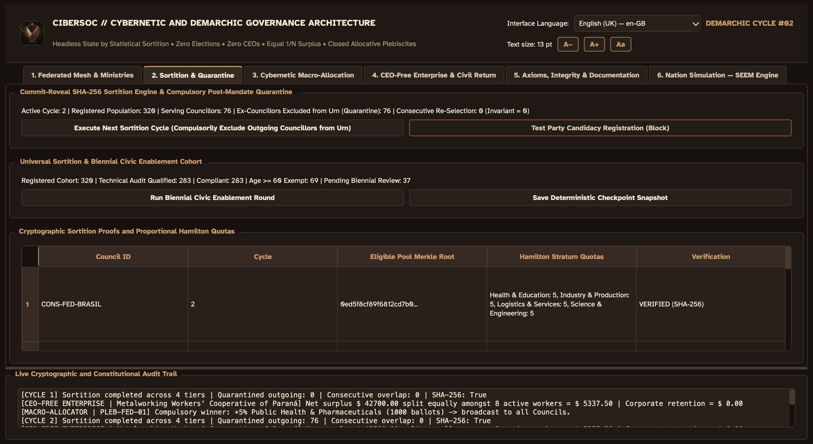
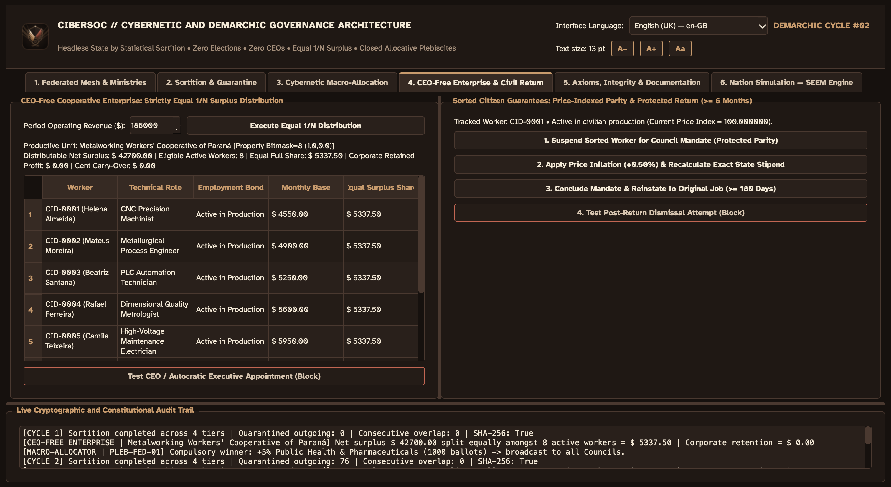

# CIBERSOC — Cybernetic and Demarchic Governance Architecture (v2.1.0)

<p align="center">
  
</p>

<p align="center">
  <a href="https://github.com/PJ-Oliveira/cibersoc/actions/workflows/ci.yml"></a>
  <a href="#prerequisites--installation"></a>
  <a href="#running-the-desktop-ui-pyside6"></a>
  <a href="#running-the-test-suite-100-coverage"></a>
  <a href="#federated-council-proportionality-engine"></a>
  <a href="#technical-documentation--explanations-docs"></a>
  <a href="docs/demo/index.html"></a>
  <a href="LICENSE"></a>
</p>

> **Methodological & Scientific Scope Note**  
> **CIBERSOC** is an open-source **computational mechanism-design, social-choice, and economic-cybernetics research laboratory**. Building on formal institutional theory (Aristotle's analysis of sortition vs. elections, Arrow and Black's social-choice theorems, Hurwicz–Maskin mechanism design, Leontief sparse input-output systems, and Cockshott & Cottrell's labour-time planning models), this repository encodes non-electoral, horizontal governance axioms as deterministic, cryptographically verifiable software and evaluates them against institutional counterfactuals via Common-Random-Numbers (CRN) simulation. It is strictly an academic, civic-engineering, and mathematical modeling platform.

---

## 1. Overview & Formal Institutional Mechanisms

**CIBERSOC** implements a self-contained, auditable computational model of **Cybernetic and Demarchic Governance** in pure Python (`3.12–3.14`), paired with an accessible **PySide6 (Qt 6.12)** desktop client, a zero-install interactive HTML5/WebCrypto browser laboratory ([`docs/demo/index.html`](docs/demo/index.html)), and complete trilingual parity (**English (UK)**, **Português**, and **Español**).

The platform formalises and verifies six interlocking institutional mechanisms:
- **Stratified Cryptographic Sortition (Zero Elections, Zero Party Apparatus):** Deliberative seats across sectoral, municipal, state, and federal councils are staffed exclusively through unbiased probability sampling (`Commit-Reveal SHA-256` multi-source entropy beacons + `HMAC-SHA256` rejection-sampled DRBG + exact integer Hamilton stratum quotas), paired with compulsory post-mandate quarantine (`0` consecutive re-selection).
- **Acéphalous Federated Council Mesh:** Unitary executive offices (*President*, *Prime Minister*, *Governor*, *Mayor*) are structurally absent. Councils are coordinated exclusively by a sorted logistical **Secretary-General** (`voting_weight = 1`, zero veto power, zero unilateral decree authority), while odd-numbered **Popular Jury** benches rotate alternates deterministically per case via cryptographic DRBG.
- **Horizontal Cooperative Enterprises (Zero CEOs, Exact $1/N$ Surplus Sharing):** Productive units operate under non-alienable usufruct rights `[Use=1, Sell=0, Buy=0, Inherit=0]` (`state_code = 8`). Executive hierarchy is barred; 100% of net period operating surplus (after audited materials, physical depreciation, macro-social contribution, and Ricardian capital-intensity equalisation) is distributed equally ($1/N$) per worked integer day using exact fixed-point rational reduction (`Decimal` + `math.gcd`) with `$0.00` corporate retention.
- **Closed Cybernetic Macro-Planning & Labour-Time Conservation:** Citizens vote exclusively on quantitative macroeconomic resource allocations (never on personal candidates). Ballots map into Embedded Labour Shares satisfying $s_j = 100 \cdot \frac{H_j y_j^*}{\sum_k H_k y_k^*}$, solved through Compressed Sparse Row (`CSR`) Gauss–Seidel Leontief solvers, Jacobi embedded-labour vectors, Cockshott short-run Harmony capacity relaxation, and iterative ecological carbon-boundary controls.
- **Civilian Multi-Signature Control over Defence & Public Security:** Federal Defence chambers exclude military personnel from political seats and require cryptographic multi-signature authorisation ($\ge \lceil 2/3 \cdot |D| \rceil$ sorted civilian councillors + civilian minister + Secretary-General certification) before any strategic order executes.
- **CPI-Indexed Stipend Parity, Civic Enablement & Post-Mandate Stability:** Sorted councillors receive inflation-indexed stipends matching their prior civil earnings and return to their original workplace under a statutory $\ge 180$-day anti-dismissal lock, complemented by a periodic **Civic Enablement Exam** scheduler with automatic statutory exemption from age 60.

---

## 2. Interactive Zero-Install Browser Laboratory (`docs/demo/index.html`)

To inspect the core mathematical models without installing Python or Qt, open [`docs/demo/index.html`](docs/demo/index.html) directly in any modern browser (or serve via GitHub Pages). The standalone single-file laboratory includes full `en-GB` / `pt` / `es` live translation and four interactive modules:
1. **SEEM National Counterfactual Simulator (Brazil, 150.7M Citizens):** Interactive Canvas map of 10 Brazilian macro-regional poles with input-output corridors and live **Common-Random-Numbers (CRN)** comparison across **(A) CIBERSOC Demarchy**, **(B) Electoral Oligarchy**, and **(C) Bureaucratic Centralism**.
2. **Hoeffding Pivotal-Ballot & WebCrypto Sortition Verifier:** Live lower-tail Hoeffding bound calculator alongside real browser `crypto.subtle.digest('SHA-256', ...)` Commit-Reveal + Hamilton quota sortition.
3. **Leontief–Cockshott Cybernetic Planner:** Real-time sparse solver verifying $\mathbf{H}\cdot\mathbf{y}^* \equiv \mathbf{l}\cdot\mathbf{x}$, short-run Harmony relaxation, and ecological carbon-ceiling feedback.
4. **Horizontal $1/N$ Cooperative Ledger:** Exact integer-day rational surplus division with Ricardian capital-endowment equalisation and `$0.00` corporate retention.

---

## 3. Visual Identity: "Wings of Freedom" Constructivist Espresso Design

The visual system unites geometric **"Wings of Freedom"** heraldry with **Constructivist Espresso (`DarkCappuccinoPalette`)** ergonomics:
- **Vector Emblem & Multi-Resolution Icon:** [`assets/icons/cibersoc_freedom_wings.svg`](assets/icons/cibersoc_freedom_wings.svg) and [`assets/icons/cibersoc_emblem.png`](assets/icons/cibersoc_emblem.png) combine golden crema and roasted terracotta wings, an industrial cybernetic planning gear, broken chains at the base, and an apex star across window titles and the macOS Dock.
- **WCAG AA Low-Fatigue Palette:** Deep espresso (`#16110E`), dark roast panels (`#1F1814`), moka cards (`#29201B`), crema amber highlights (`#C89B6D`), sage green directives (`#84A97C`), terracotta constitutional alerts (`#C26653`), and high-contrast ivory typography (`#F4EAD8`).
- **Accessible Responsive Typography:** Ships with bundled **Atkinson Hyperlegible** fonts, guaranteed **12 pt minimum** font size, dynamic scaling up to **32 pt** (`A−`, `A+`, `Aa` or `Ctrl++` / `Ctrl+-` / `Ctrl+0`), and zero horizontal overflow down to `680×500` viewports.

---

## 4. Federated Council Proportionality Engine

Council seat counts follow a strictly proportional mathematical rule eliminating arbitrary assembly sizing:
- **Sectoral Base (Neighbourhoods):** **10 seats** per sector (`CONS-SET-BOQUEIRAO`: 10, `CONS-SET-MATRIZ`: 10), staffing all ministerial chambers and the logistical Secretary-General.
- **Municipal Council (`CONS-MUN-CURITIBA`):** **20 seats**, strictly $1:1$ proportional to the aggregate of subordinate sectoral councils:
  $$N_{\text{municipal}} = 1.0 \times \sum_{s \in \mathcal{S}(M)} N(s) = 10 + 10 = 20$$
  Preserves agile small-group deliberation while guaranteeing a 4-member Justice chamber capable of seating odd-numbered 3-juror **Popular Jury** benches with deterministic per-case alternate rotation.
- **State Council (`CONS-EST-PARANA`):** **16 seats** via $4:5$ regional consolidation.
- **Federal Council (`CONS-FED-BRASIL`):** **20 seats**, maintaining national inter-council coordination and 100% civilian supremacy over the Ministry of Defence.
- **Active Cohort & Quarantine Invariant:** **76 active councillors** across the 5 federated councils (`320` local registry citizens; Cycle `#01`: `76` serving, `0` quarantined; Cycle `#02`: `76` quarantined, `244` eligible, `76` newly sorted, `0` consecutive re-selection).

---

## 5. Desktop Workspaces & Visual Preview

The PySide6 desktop interface provides 6 integrated workspaces (`Ctrl+1` … `Ctrl+6`):
1. **Federated Mesh & Ministries:** Interactive 4-tier council topology, demand escalation, logistical Secretary-General authentication, Popular Jury adjudication, Public Security oversight, and Civilian Multi-Sig Defence gates.
2. **Sortition, Quarantine & Civic Enablement:** Multi-source SHA-256 Commit-Reveal sortition, Merkle/Hamilton cryptographic proof inspector, periodic Civic Enablement rounds (with statutory age-60 exemption), and snapshot persistence.
3. **Cybernetic Macro-Allocation:** Coercion-resistant blinded plebiscites, CSR Leontief + Jacobi embedded-labour solver, Cockshott Harmony relaxation, and iterative clearing/carbon-ceiling feedback.
4. **CEO-Free Enterprise & Civil Return:** Exact $1/N$ rational surplus ledger, horizontal `[1,0,0,0]` usufruct checks, CPI-indexed mandate stipends, and $\ge 180$-day post-return job protection.
5. **Axioms, Integrity & Documentation:** Trilingual charter, FullHD wallpaper exporter, live repository scanner auditing AST/tokenize Clean Code compliance and standalone completeness, and native Markdown + Mermaid diagram reader for all trilingual manuals.
6. **Nation Simulation — 3D SEEM Engine:** Interactive 3D WebGL/Three.js + QPainter simulation of **150,700,000 citizens** across 10 Brazilian poles with continental vector boundaries, 3D input-output trade arcs, and live **A/B/C Institutional Regime Counterfactuals** under Common Random Numbers.

<p align="center">
  <b>Nation Simulation — 3D SEEM Engine & CRN Regime Comparator (Tab 6)</b><br/>
  
</p>

<p align="center">
  <b>Federated Mesh, Popular Juries & Civilian Multi-Sig Defence (Tab 1)</b><br/>
  
</p>

<p align="center">
  <b>Stratified Sortition, Quarantine & Civic Enablement (Tab 2)</b><br/>
  
</p>

<p align="center">
  <b>Cybernetic Macro-Allocation, Labour Shares & Plan Feedback (Tab 3)</b><br/>
  
</p>

<p align="center">
  <b>Horizontal Cooperative Enterprise & Mandate Protection (Tab 4)</b><br/>
  
</p>

<p align="center">
  <b>Architectural Charter & Standalone Integrity Audit (Tab 5)</b><br/>
  
</p>

---

## 6. Technical Documentation & Explanations (`docs/`)

All theoretical derivations, mathematical proofs, UI guides, and operational playbooks are maintained under strict trilingual symmetry:

### 🇧🇷 Português (`docs/pt/`)
- [**01. Fundamentos Teóricos e Defesa Lógica**](docs/pt/01_FUNDAMENTOS_TEORICOS_E_DEFESA_LOGICA.md) — *Teoria da escolha social, prova de cauda inferior via Desigualdade de Hoeffding para voto pivotal e convergência exponencial da demarquia, e refutação formal às críticas ao planejamento cibernético.*
- [**02. Guia da Interface de Usuário (UI)**](docs/pt/02_GUIA_DA_INTERFACE_UI.md) — *Manual completo das 6 abas em PySide6, paleta Constructivist Espresso, atalhos de teclado e acessibilidade tipográfica.*
- [**03. Manual de Operação do Simulador**](docs/pt/03_MANUAL_DE_OPERACAO_DO_SIMULADOR.md) — *Playbooks operacionais, execução CLI trilíngue (`run_simulation.py`), API programática em Python e verificação QA.*
- [**04. Mecânica Subjacente (Under the Hood)**](docs/pt/04_MECANICA_SUBJACENTE_UNDER_THE_HOOD.md) — *Árvores de Merkle, Commit-Reveal SHA-256, DRBG sem viés, cotas de Hamilton, matrizes CSR de Leontief, identidade de cotas de trabalho e simulação contrafactual CRN.*

### 🇬🇧 English (UK) (`docs/en-GB/`)
- [**01. Theoretical Foundations and Logical Defence**](docs/en-GB/01_THEORETICAL_FOUNDATIONS_AND_LOGICAL_DEFENCE.md) — *Mechanism-design axioms, lower-tail Hoeffding proof of single-ballot irrelevance vs. exponential sortition concentration, and analytical defence of sparse cybernetic planning.*
- [**02. User Interface (UI) Guide**](docs/en-GB/02_UI_GUIDE.md) — *Complete guide to the 6 PySide6 workspaces, responsive layout modes, keyboard shortcuts, and accessible typography.*
- [**03. Simulator Operation Manual**](docs/en-GB/03_SIMULATOR_OPERATION_MANUAL.md) — *Step-by-step playbooks, headless CLI runner, programmatic Python API, and 100% coverage verification.*
- [**04. Under the Hood Mechanics**](docs/en-GB/04_UNDER_THE_HOOD_MECHANICS.md) — *Cryptographic sortition proofs, rational integer-day surplus division, CSR Leontief–Cockshott solvers, and SEEM CRN regime architecture.*

### 🇪🇸 Español (`docs/es/`)
- [**01. Fundamentos Teóricos y Defensa Lógica**](docs/es/01_FUNDAMENTOS_TEORICOS_Y_DEFENSA_LOGICA.md) — *Diseño de mecanismos institucionales, demostración de cola inferior de Hoeffding para voto pivotal y concentración demárquica, y defensa analítica de la planificación cibernética.*
- [**02. Guía de la Interfaz de Usuario (UI)**](docs/es/02_GUIA_DE_LA_INTERFAZ_UI.md) — *Guía integral de las 6 pestañas en PySide6, paleta cromática, atajos de teclado y escala tipográfica.*
- [**03. Manual de Operación del Simulador**](docs/es/03_MANUAL_DE_OPERACION_DEL_SIMULADOR.md) — *Playbooks de simulación, informe CLI trilingüe, API en Python y auditoría automatizada.*
- [**04. Mecánica Subyacente (Under the Hood)**](docs/es/04_MECANICA_SUBYACENTE_UNDER_THE_HOOD.md) — *Árboles de Merkle, balizas Commit-Reveal, DRBG insesgado, cuotas de Hamilton, matrices dispersas CSR y motor contrafactual SEEM.*

---

## 7. Prerequisites, Installation & Execution

### Requirements
- **macOS** (13+), **Linux**, or **Windows**
- **Python 3.12, 3.13, or 3.14**
- **[`uv`](https://docs.astral.sh/uv/)** deterministic package manager

### Setup
```bash
git clone https://github.com/PJ-Oliveira/cibersoc.git
cd cibersoc
uv sync --all-extras --all-groups
```

### Launching the Desktop UI (PySide6)
```bash
uv run python cibersoc_ui.py
# or via installed console script:
uv run cibersoc-ui
```

### Launching the Trilingual CLI Report
```bash
uv run python run_simulation.py --locale en-GB
uv run python run_simulation.py --locale pt
uv run python run_simulation.py --locale es
```

---

## 8. Running the Test Suite & Architectural Invariants (100% Coverage)

```bash
uv run pyright src/cibersoc
QT_QPA_PLATFORM=offscreen uv run pytest
```

Every commit is verified against **Five Hard Architectural Invariants**:
1. **100.00% Statement and Branch Coverage:** Enforced via `pytest-cov` (`--cov=src/cibersoc --cov-branch --cov-fail-under=100`) and strict `pyright` static type checking (`0 errors, 0 warnings`).
2. **Zero Mocks & Zero Monkeypatching:** Test doubles (`unittest.mock`, `MagicMock`, `monkeypatch`) are banned across `tests/`. Every test exercises real cryptographic sortition, real sparse solvers, and real Qt widgets wired through explicit Dependency Injection parameters.
3. **AST-Enforced Self-Documenting Clean Code (`0` `#` Comments, `0` Docstrings in `.py`):** Verified by `audit_clean_code_compliance` via Python's `tokenize` and `ast` modules. Rather than allowing inline comments to drift out of sync with executable logic, every Python symbol must express intent through exact domain naming and static types, while mathematical proofs live in `docs/`.
4. **100% Trilingual Symmetry:** Verified across `en-GB`, `pt`, and `es` catalogues and documentation manuals.
5. **Standalone Analytical Purity:** Zero external network calls or cloud dependencies at runtime.

---

## 9. Project Structure

```text
.
├── assets/
│   ├── icons/                   # Multi-resolution SVG and PNG Wings of Freedom emblems
│   └── images/screenshots/      # High-DPI authentic workspace captures (Tabs 1-6)
├── docs/
│   ├── demo/index.html          # Zero-install trilingual HTML5/WebCrypto browser lab
│   ├── en-GB/                   # English (UK) theoretical proofs and manuals (01-04)
│   ├── pt/                      # Portuguese theoretical proofs and manuals (01-04)
│   └── es/                      # Spanish theoretical proofs and manuals (01-04)
├── simulation_data/             # Deterministic population, mesh, and checkpoint snapshots
├── src/cibersoc/
│   ├── audit.py                 # AST/lexer Clean Code and standalone integrity verifiers
│   ├── civic_exam.py            # Periodic civic enablement scheduler & age-60 exemption
│   ├── cli.py                   # Trilingual deterministic CLI report runner
│   ├── councils.py              # Federated councils, Popular Jury rotation, Defence gates
│   ├── cybernetics.py           # CSR Leontief, Jacobi labour shares, Harmony & feedback
│   ├── enterprise.py            # Horizontal [1,0,0,0] cooperative ledger (Decimal + gcd)
│   ├── mandate_protection.py    # CPI stipend parity and >=180-day reinstatement lock
│   ├── py.typed                 # PEP 561 static typing marker
│   ├── sortition.py             # SHA-256 Commit-Reveal, Merkle roots, DRBG, Hamilton quotas
│   ├── i18n/                    # Reactive localization engine and JSON catalogues
│   ├── simulation/              # SEEM 150.7M-citizen national engine & CRN regimes (A/B/C)
│   ├── ui/                      # PySide6 desktop client, 3D WebGL/QPainter map & Mermaid reader
│   └── util/                    # Deterministic checkpoint loader and serializer
├── tests/                       # 100% statement + branch test suite (zero mocks/monkeypatch)
├── CONTRIBUTING.md              # Engineering guidelines and Five Architectural Invariants
├── LICENSE                      # OSI-approved MIT License + Open Civic Architecture Notice
└── pyproject.toml               # Package metadata, console scripts, and strict QA settings
```

---

## 10. Contributing & License

Contributions grounded in mathematical, algorithmic, and software engineering rigour are welcome; see [CONTRIBUTING.md](CONTRIBUTING.md) for guidelines.

**CIBERSOC** is released under the **MIT License** (see [LICENSE](LICENSE)), accompanied by a trilingual Open Civic & Scientific Architecture Notice ensuring unrestricted academic, educational, and civic auditability.
