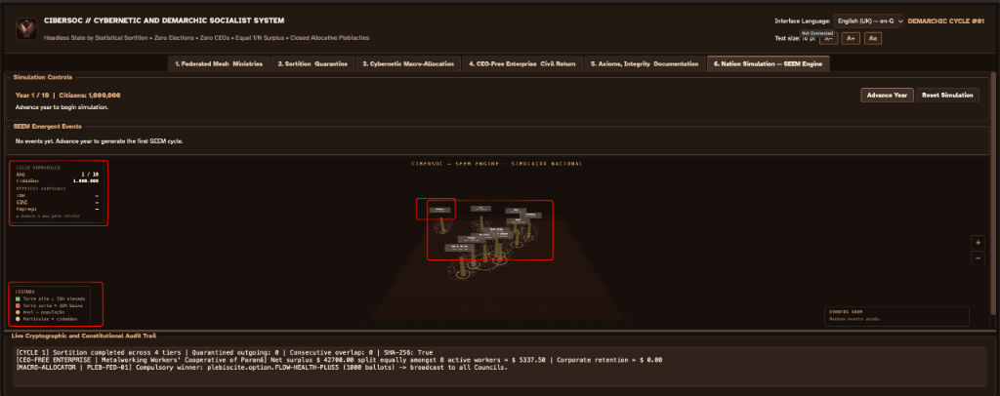
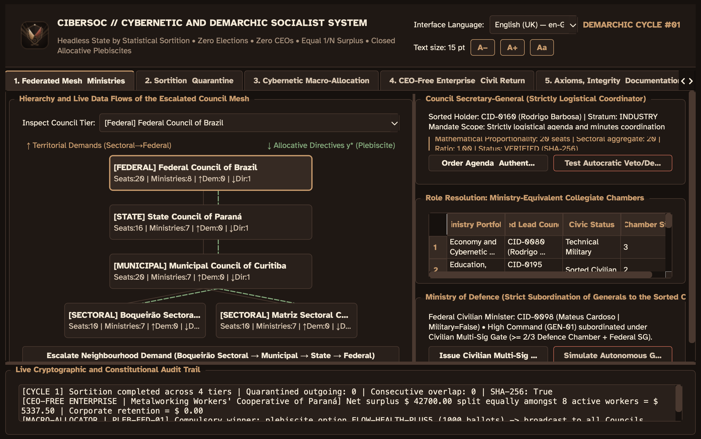
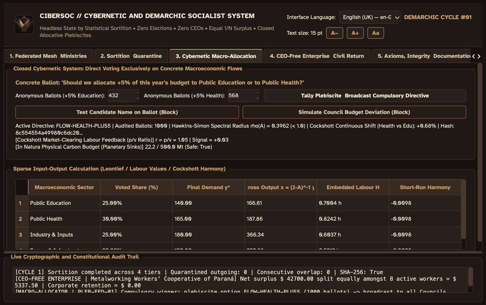
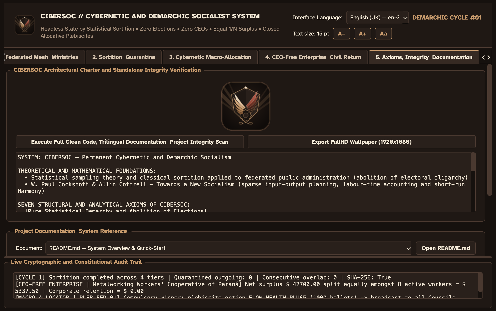

# CIBERSOC — Permanent Cybernetic and Demarchic Socialism (v2.0)

<p align="center">
  
</p>

<p align="center">
  <a href="https://github.com/PJ-Oliveira/cibersoc/actions/workflows/ci.yml"></a>
  <a href="#prerequisites--installation"></a>
  <a href="#running-the-desktop-ui-pyside6"></a>
  <a href="#running-the-test-suite-100-coverage"></a>
  <a href="#federated-council-proportionality-engine"></a>
  <a href="#technical-documentation--explanations-docs"></a>
  <a href="LICENSE"></a>
</p>

---

## 1. Introduction & Core Purpose

**CIBERSOC** is a self-contained, auditable political-economic computational platform implementing **Permanent Cybernetic and Demarchic Socialism**. Built in pure Python with a responsive **PySide6 (Qt 6.12)** desktop interface, it operates under complete trilingual parity (**English (UK)**, **Português**, and **Español**).

The system addresses the fundamental systemic failure modes of both capitalist market economies and authoritarian bureaucratic states:
- **Abolition of Electoral Coercion & Oligarchy:** All legislative, municipal, state, and federal bodies are staffed through cryptographically verifiable, stratified statistical sortition (Commit-Reveal SHA-256 + HMAC-DRBG with Hamilton stratum quotas). Professional politicians, party apparatuses, campaign financing, and the fallacy of "lesser-evilism" are structurally abolished.
- **Acéphalous State Architecture:** Supreme autocratic executive titles (*President*, *Prime Minister*, *Governor*, *Mayor*) are permanently barred. Councils are coordinated strictly by a logistical **Secretary-General** (`voting_weight = 1`, zero veto power, zero unilateral decree power).
- **CEO-Free Socialist Enterprises:** Productive units operate under strict usufruct bitmasks `[1, 0, 0, 0]`. Private ownership, equity shares, and executive boards are eliminated. 100% of net period operating surplus is distributed equally ($1/N$) amongst all active workers through exact rational arithmetic ($\mathbb{Q}$) with zero corporate capital retention.
- **Closed Cybernetic Macro-Planning:** Public resource allocation is determined by direct, binary, macroeconomic plebiscites on concrete social flows (e.g. $+5\%$ Education vs $+5\%$ Health). Plebiscite outcomes propagate compulsively to Leontief input-output matrices solved via Compressed Sparse Row (CSR) iterative solvers, Cockshott short-run capacity Harmony relaxation, and embedded labour-time accounting.
- **Civilian Multi-Sig Supremacy over Defence:** The Ministry of Defence is strictly civilian. High-ranking general officers possess zero unilateral mobilisation power, answering strictly to sorted civilian ministers under collective multi-signature authorization ($\ge 2/3$ civilian Defence Chamber quorum).
- **Seconded Worker Parity & Anti-Dismissal Locks:** Citizens sorted into council mandates receive official inflation-indexed state stipends matching their prior civil income, with constitutionally guaranteed post-mandate reinstatement and a $\ge 180$-day shield against dismissal.

---

## 2. Visual Identity: "Wings of Freedom" Soviet-Cappuccino Design

The visual identity of CIBERSOC unites the iconic **"Wings of Freedom"** heraldry with **Soviet Constructivist geometry** and a warm, low-fatigue **Dark Cappuccino palette**:

- **Emblem & Application Icon:** A multi-resolution vector emblem ([`assets/icons/cibersoc_freedom_wings.svg`](assets/icons/cibersoc_freedom_wings.svg) and [`assets/icons/cibersoc_emblem.png`](assets/icons/cibersoc_emblem.png)) featuring overlapping geometric wings (golden crema and roasted terracotta), a cybernetic industrial planning cogwheel, severed chains of servitude at the base, and an apex starburst. It powers the application icon, window decorations, and the macOS Dock icon.
- **Symbolic Foundation:** Reflects the relentless human impulse toward collective emancipation and self-determination—the refusal to exist passively behind confining walls or under autocratic subjugation, advancing unceasingly toward permanent popular sovereignty without career masters.
- **Chromatic Palette:** Deep espresso (`#16110E`), dark roast panels (`#1F1814`), moka cards (`#29201B`), crema amber highlights (`#C89B6D`), sage green directives (`#84A97C`), terracotta alerts (`#C26653`), and ivory primary text (`#F4EAD8`).

---

## 3. Federated Council Proportionality Engine

Council seat counts are governed by a **mathematically calculated, strictly proportional framework** eliminating arbitrary assembly sizing:

- **Sectoral Base (Neighborhoods):** Sized at **10 seats** per sector (`CONS-SET-BOQUEIRAO`: 10, `CONS-SET-MATRIZ`: 10), ensuring complete staffing across the 7 ministerial portfolios and logistical Secretary-General.
- **Municipal Council:** Sized at **20 seats**, strictly proportional ($1:1$) to the aggregate of all subordinate sectoral council members:
  $$N_{\text{municipal}} = 1.0 \times \sum_{s \in \mathcal{S}(M)} N(s) = 10 + 10 = 20$$
  - *Non-inflated:* Preserves agile small-group deliberative efficiency (Condorcet/Olson optimal group bounds) and prevents demographic sample exhaustion during post-mandate quarantines.
  - *Non-negligible:* Guarantees a 4-member Justice chamber, sustaining the mandatory 3-member odd-numbered Popular Jury bench.
- **State Council (`CONS-EST-PARANA`):** Sized at **16 seats** via $4:5$ regional deliberative consolidation.
- **Federal Council (`CONS-FED-BRASIL`):** Sized at **20 seats**, providing national coordination and civilian command parity over the Ministry of Defence.
- **Active Serving Cohort:** **76 councillors** serving across the 5 federated councils (Cycle #01: 76 active, 0 in quarantine; Cycle #02: 76 outgoing in quarantine, 244 eligible, 76 newly sorted; 0 consecutive re-selection invariant).

---

## 4. Technical Documentation & Explanations (`docs/`)

All theoretical foundations, architectural proofs, user interface manuals, and operational guides are documented in depth across three languages and accessible natively inside the desktop UI (Tab 6) or on GitHub:

### 🇧🇷 Português (`docs/pt/`)
- [**01. Fundamentos Teóricos e Defesa Lógica**](docs/pt/01_FUNDAMENTOS_TEORICOS_E_DEFESA_LOGICA.md)  
  *Crítica dedutiva ao sistema eleitoral-representativo, refutação da falácia do "mal menor", fundamentos matemáticos do sorteio estratificado com beacon commit-reveal e provas SHA-256.*
- [**02. Guia da Interface do Usuário (UI)**](docs/pt/02_GUIA_DA_INTERFACE_UI.md)  
  *Manual completo da janela PySide6: malha de conselhos, controles de sorteio, painel cibernético, cooperativa e controles de acessibilidade tipográfica.*
- [**03. Manual de Operação do Simulador**](docs/pt/03_MANUAL_DE_OPERACAO_DO_SIMULADOR.md)  
  *Instruções para execução via CLI (`run_simulation.py`), testes de salvaguarda anti-golpe militar e auditoria de integridade.*
- [**04. Mecânica Subjacente (Under the Hood)**](docs/pt/04_MECANICA_SUBJACENTE_UNDER_THE_HOOD.md)  
  *Estruturas internas: matrizes esparsas CSR, inversão de Leontief, alocação de Hamilton para cotas, cálculo de trabalho incorporado e garantias de blindagem jurídica de emprego.*

### 🇬🇧 English (UK) (`docs/en-GB/`)
- [**01. Theoretical Foundations & Logical Defence**](docs/en-GB/01_THEORETICAL_FOUNDATIONS_AND_LOGICAL_DEFENCE.md)  
  *Decision-theoretic critique of electoral coercion, rejection of lesser-evilism, and mathematical proof of demarchic sortition.*
- [**02. User Interface (UI) Guide**](docs/en-GB/02_UI_GUIDE.md)  
  *Complete manual for the PySide6 desktop interface, council canvas visualization, and accessible typography controls.*
- [**03. Simulator Operation Manual**](docs/en-GB/03_SIMULATOR_OPERATION_MANUAL.md)  
  *Step-by-step operations for headless CLI simulations, civilian command gate tests, and verification suites.*
- [**04. Under-the-Hood Mechanics**](docs/en-GB/04_UNDER_THE_HOOD_MECHANICS.md)  
  *Detailed mathematical algorithms: CSR sparse matrices, Leontief gross output, Hamilton largest remainder, and Jacobi embedded labour.*

### 🇪🇸 Español (`docs/es/`)
- [**01. Fundamentos Teóricos y Defensa Lógica**](docs/es/01_FUNDAMENTOS_TEORICOS_Y_DEFENSA_LOGICA.md)  
  *Crítica formal a la coacción electoral, superación del «mal menor», y formulación axiomática de la demarquía estratificada.*
- [**02. Guía de la Interfaz de Usuario (UI)**](docs/es/02_GUIA_DE_LA_INTERFAZ_UI.md)  
  *Guía operativa de la aplicación de escritorio PySide6, lienzo de la malla de consejos y controles de escala de texto.*
- [**03. Manual de Operación del Simulador**](docs/es/03_MANUAL_DE_OPERACION_DEL_SIMULADOR.md)  
  *Instrucciones de ejecución por línea de comandos, protocolos de seguridad ciudadana y auditorías de código limpio.*
- [**04. Mecánica Subyacente (Under the Hood)**](docs/es/04_MECANICA_SUBYACENTE_UNDER_THE_HOOD.md)  
  *Desglose algorítmico: matrices dispersas, balance insumo-producto, vector de trabajo incorporado y cuotas de Hamilton.*

---

## 5. Accessible & Reader-Friendly Typography

The interface includes a **fully responsive typography scaling system** designed for reading comfort:
- **Minimum font size:** Guaranteed minimum of **12 pt** across all screens, buttons, tables, badges, and diagrams.
- **Readable typography:** Ships with **Atkinson Hyperlegible** (specifically engineered for character distinction and low-vision legibility), falling back gracefully to *Lexend*, *Verdana*, *Tahoma*, *Segoe UI*, or *Helvetica Neue*.
- **Interactive size controls:** Header buttons (`A−`, `A+`, `Aa`) allow scaling from **12 pt** to **32 pt**.
- **Keyboard shortcuts:**
  - `Ctrl + =` or `Ctrl + +` (or `Cmd + +` on macOS): Increase text size.
  - `Ctrl + -` (or `Cmd + -` on macOS): Decrease text size.
  - `Ctrl + 0` (or `Cmd + 0` on macOS): Reset text size to default.
- **Adaptive layout reflow:** When the font is enlarged, data tables automatically increase minimum section widths, row heights, and elide text safely; council diagram nodes expand to contain text without overlapping; and scroll areas ensure zero clipped content.
- **Session persistence:** Your preferred text size is automatically saved in application settings.

---

## 6. Prerequisites & Installation

### Requirements
- **macOS** (tested on macOS 13+), **Linux**, or **Windows**.
- **Python 3.12+** (supports Python 3.14).
- **uv** – fast, deterministic Python package manager:
  ```bash
  curl -LsSf https://astral.sh/uv/install.sh | sh
  # or via Homebrew on macOS:
  brew install uv
  ```

### Installation
```bash
git clone https://github.com/PJ-Oliveira/cibersoc.git
cd cibersoc
uv sync
```
`uv sync` sets up an isolated `.venv` with all required dependencies pinned deterministically in `uv.lock`.

---

## 7. Running the System

### Running the Desktop UI (PySide6)
```bash
.venv/bin/python cibersoc_ui.py
# or via console entrypoint:
.venv/bin/cibersoc-ui
```

The desktop UI provides 6 dedicated workspaces:
1. **Councils & Mesh Workspace:** Interactive canvas rendering the 4-tier federated council topology, upward demand escalation, Secretary-General collegiate authentication, mathematical proportionality audit, popular juries, and civilian defence command gates.
2. **Sortition & Quarantines Workspace:** Stratified sortition engine with SHA-256 Merkle proofs, verifiable random beacons, and post-mandate quarantine tracking.
3. **Cybernetic Planning Workspace:** Leontief input-output matrices, macro-allocation plebiscites, Jacobi embedded-labour solver, and capacity harmony relaxation.
4. **Cooperative Enterprise & Mandate Protection:** 100% equal surplus distribution (no CEO, no private owner), civil stipend parity during mandates, and post-mandate employment stability locks.
5. **Architectural Charter & Audit Console:** Live Clean Code and project integrity scanner verifying zero mocks, comment-free code, and trilingual documentation completeness.
6. **Nation Simulation — SEEM Engine:** 3D WebGL/Three.js macroscopic simulation of 1,000,000 citizens across 10 Brazilian regions, tracking HDI color gradients, GINI coefficients, orbital population rings, and real-time emergent event streams.

#### Visual Interface Preview

<p align="center">
  <b>Nation Simulation — 3D SEEM Engine (Tab 6)</b><br/>
  
</p>

<p align="center">
  <b>Federated Mesh Ministries & Council Proportionality (Tab 1)</b><br/>
  
</p>

<p align="center">
  <b>Cybernetic Macro-Allocation & Planning Matrix (Tab 3)</b><br/>
  
</p>

<p align="center">
  <b>Architectural Charter & Standalone Integrity Audit (Tab 5)</b><br/>
  
</p>

### Running the Trilingual CLI Simulator
```bash
# English (UK)
.venv/bin/python run_simulation.py --locale en-GB

# Português
.venv/bin/python run_simulation.py --locale pt

# Español
.venv/bin/python run_simulation.py --locale es
```

---

## 8. Running the Test Suite (100% Coverage)

Run the automated test suite enforcing clean code standards, zero mocks, and full statement/branch coverage:

```bash
QT_QPA_PLATFORM=offscreen .venv/bin/pytest
```

The suite enforces:
- **100.00% statement and branch coverage** across all production modules (`pytest-cov` with `--cov-fail-under=100`).
- **Zero mocks policy:** Prohibits mocks, monkeypatching, and synthetic doubles across the entire test suite; every test executes against real domain models and real Qt event loops.
- **Clean Code audit:** Enforces 0 comments and 0 docstrings in production code files.
- **Project integrity:** Guarantees that all documentation, locales, and assets are self-contained.

---

## 9. Project Structure

```
.
├── assets/
│   └── icons/                   # High-res SVG and PNG Wings of Freedom emblems
├── src/
│   └── cibersoc/
│       ├── audit.py             # Clean code and project integrity verifiers
│       ├── cli.py               # Trilingual CLI reporting runner
│       ├── councils.py          # Demarchic councils, proportionality engine, and defence gates
│       ├── cybernetics.py       # Leontief input-output matrices and plebiscites
│       ├── enterprise.py        # Cooperative enterprise without CEOs
│       ├── mandate_protection.py# Seconded worker parity and stability protection
│       ├── sortition.py         # Stratified sortition, Merkle proofs, and DRBG
│       ├── i18n/                # Localization catalog and JSON translation files
│       │   └── catalogues/      # en_GB.json, pt.json, es.json
│       └── ui/                  # PySide6 desktop application
│           ├── assets/fonts/    # Bundled Atkinson Hyperlegible readable fonts
│           ├── icon.py          # Multi-resolution emblem and dock icon generator
│           ├── main_window.py   # Main window with 6 workspaces and responsive typography
│           ├── mesh_canvas.py   # Responsive 4-tier council diagram canvas
│           ├── state.py         # Multi-cycle simulation orchestrator
│           └── theme.py         # Dark Cappuccino palette and scalable styles
├── docs/                        # Trilingual technical and theoretical documentation
│   ├── en-GB/                   # English (UK) manuals and theoretical foundations
│   ├── pt/                      # Portuguese manuals and theoretical foundations
│   └── es/                      # Spanish manuals and theoretical foundations
├── tests/                       # Complete test suite (100% coverage, zero mocks)
├── .gitignore                   # Clean Git ignore rules (virtualenvs, caches, OS files)
├── pyproject.toml               # Project metadata, scripts, and build settings
├── uv.lock                      # Pinned reproducible dependencies
├── LICENSE                      # Open Civic Architecture Declaration (v2.0)
└── README.md                    # Project overview, quick-start, and documentation links
```

---

## 10. Contributing

We welcome contributions grounded in mathematical and civic rigor. All contributions must preserve CIBERSOC's **Five Architectural Invariants** (100.00% statement and branch coverage, zero mocks, zero production comments/docstrings, trilingual symmetry, and analytical purity).

Please consult [CONTRIBUTING.md](CONTRIBUTING.md) for full guidelines, testing instructions, and pull request requirements.

---

## 11. License

CIBERSOC is released under the **Open Civic Architecture Commons Declaration (v2.0)**. See [LICENSE](LICENSE) for details. All source code, mathematical formulations, and documentation are provided freely for civic verification, study, adaptation, and collective deployment.
