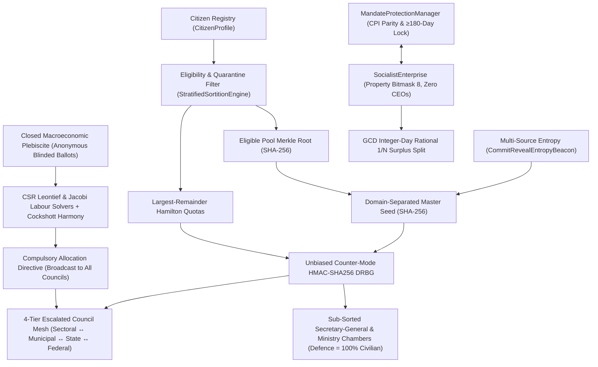

# 04. Under the Hood Mechanics

## 1. End‑to‑End Subsystem Data Flow (Mermaid Diagram)

The diagram shows every major component, its cryptographic guarantees and how data flows from the citizen registry to the final allocation directive.

---

## 2. Cryptographic Sortition & Demarchic Quarantine (`sortition.py`)
### 2.1 Deterministic Merkle Tree (`compute_merkle_root`)
1. Deduplicate and lexicographically sort citizen IDs `c₁ < c₂ < … < c_m`.  An empty set yields `SHA256("EMPTY_ELIGIBLE_POOL")`.
2. Compute leaf digests `h₀,k = SHA256(c_k)`.
3. Pairwise hash upwards, duplicating the last node when the level length is odd, until a single 256‑bit root `R_Merkle` remains.
4. Any single‑bit change flips `R_Merkle` with probability `1‑2⁻²⁵⁶`.

### 2.2 Multi‑Source Commit‑Reveal (`CommitRevealEntropyBeacon`)
1. **Commit Phase:** At least `M≥2` independent institutions publish `C_s = SHA256(seed_s || "||" || nonce_s)`.
2. **Reveal Phase:** After locking, each source reveals `(seed_s, nonce_s)`; verification uses constant‑time `hmac.compare_digest`.
3. **Master Seed Derivation:** Sorted sources are concatenated with the scope, cycle and Merkle root:
```
S_master = SHA256(
    "CIBERSOC_SORTITION_V2|" || scope || "|" || t || "|" || R_Merkle
    || "|" || source_id || ":" || seed_s || ":" || nonce_s for each s
)
```
Embedding `R_Merkle` guarantees the eligible pool cannot be altered after seeing the entropy commitments.

### 2.3 Bias‑Free Counter‑Mode DRBG (`CounterModeHmacDrbg`)
The DRBG draws 64‑bit integers from the first 8 bytes of `HMAC‑SHA256(K=S_master, counter_be)`.  To avoid modulo bias, it computes a rejection threshold `L = 2⁶⁴ – (2⁶⁴ mod B)` and discards any sample `u ≥ L`.  The accepted `u` is uniformly distributed over `{0,…,B‑1}`.

### 2.4 Proportional Hamilton Quotas (`allocate_proportional_hamilton_quotas`)
Given strata populations `P_s` and total seats `S` (≤ total population):
1. Compute exact floor quotas `q_s^floor = ⌊P_s·S / P_total⌋` and remainders `r_s = (P_s·S) mod P_total` using integer arithmetic only.
2. Distribute the remaining `S – Σ q_s^floor` seats in descending order of `(-r_s, s)`.  Zero‑population strata never receive a seat.

### 2.5 Compulsory Quarantine & Civilian‑First Role Assignment
- **Quarantine Invariant:** When `register_mandate_completion(cid_list, t)` is called, each outgoing councillor is recorded in `_quarantined_until_cycle[cid] = max(prev, t + cooldown_cycles)`.  `is_eligible(cid, t')` returns `False` for all `t' ≤ t + cooldown_cycles`, guaranteeing `C_t ∩ C_{t+1} = ∅`.
- **Internal Role Sub‑Sortition:** Derives a secondary seed `SHA256("INTERNAL_ROLES|" || S_master)`, shuffles the drawn councillors, assigns index 0 to the logistical `SecretaryGeneral`, filters out military personnel first for the `DEFENCE` ministry (raising `CivilianSupremacyViolationError` if none), then allocates the remaining portfolios.
- **Zero‑Trust Public Verification (`verify_audit_proof`):** Checks (1) unique eligible IDs, (2) non‑empty bounded selection, (3) ≥ 2 commitments, (4) Merkle root equality, (5) source‑reveal alignment, (6) every commitment hash, (7) master seed derivation, (8) Hamilton quotas, (9) deterministic DRBG replay.

---

## 3. Council Mesh & Civilian Multi‑Sig Gate (`councils.py`)
- **Escalated Topology:** `EscalatedCouncilMesh.EXPECTED_PARENT_TIER` enforces the strict hierarchy `SECTORAL → MUNICIPAL → STATE → FEDERAL → None` and forbids a `DEFENCE` ministry outside the Federal tier.
- **Federated Seat Proportionality (`FederatedSeatProportionality`):** Enforces linear scaling $N_{\text{municipal}} = \lambda_{\text{mun}} \sum_{s \in \mathcal{S}(M)} N(s)$ with $\lambda_{\text{mun}} = 1.0$ (20 municipal seats in Curitiba strictly proportional to the 20 sectoral members of Boqueirão [10] and Matriz [10]). Guarantees 4 seats in Justice (ensuring the $\ge 3$ Popular Jury bench) while bounding the assembly at 20 members to preserve deliberative efficacy and prevent demographic quarantine exhaustion.
- **Secretary‑General Logic:** `order_meeting_agenda` sorts deterministically by `(-urgency, seq, item_id)`.  `authenticate_resolution` ensures all voters belong to `valid_member_ids` and that `votes_in_favour ≥ (N//2)+1` before computing a resolution hash; any veto or unilateral decree raises `AutocraticActForbiddenError`.
- **Civilian‑Military Command Gate:** Instantiation rejects any military minister or military member in the Defence Chamber.  `issue_strategic_order` requires: (a) a registered general, (b) signature of the sorted civilian minister, (c) agenda certification by the Federal Secretary‑General, and (d) approval by at least `⌈2/3·|D|⌉` sorted civilian Defence Chamber members.

---

## 4. Rational Fixed‑Point Enterprise Accounting (`enterprise.py`)
1. **Property Bitmask:** `PropertyRightsBitmask.state_code` evaluates `(use << 3) | (sell << 2) | (buy << 1) | inherit`.  Only `[True, False, False, False]` (`8`) passes `assert_socialist_productive_unit()`.
2. **Exact Integer‑Day Rational Surplus Division:** Floating‑point division introduces drift (e.g. `7 * Decimal(1)/Decimal(7) ≈ 1.0000000000000000000000000003`).  The method sums exact worker‑day integers `T = Σ d_w`, reduces each fraction by `g_w = gcd(d_w, T)`, and quantises only once with `ROUND_DOWN` to cent precision:
```
 s_w = floor( Π_net * (d_w / g_w) / (T / g_w) )_{0.01}
 r_next = Π_net - Σ s_w
```
The invariant `0 ≤ r_next < N_active·0.01` holds mathematically, and corporate retained profit is always `Decimal("0.00")`.

---

## 5. Sparse Input‑Output, Labour Values & Harmony (`cybernetics.py`)
1. **CompressedSparseRowMatrix:** Stores only non‑zero technical coefficients (`|a_ij| > 1e‑15`) in three arrays, enabling `A·x` and `H·A` in `O(nnz(A))` time.
2. **Spectral Check (Hawkins‑Simon):** `estimate_spectral_radius` runs a normalised power iteration to verify `ρ(A) < 1`, guaranteeing the existence of `(I‑A)⁻¹`.
3. **Gauss‑Seidel Gross Output & Jacobi Embedded Labour:** Iterates until relative change `< 1e‑8`.  The labour identity `H·y ≡ l·x` holds at convergence.
4. **Short‑Run Harmony Relaxation:** Scales initial output into the feasible box `[0, x_max]` and iteratively adjusts each sector proportionally to `(Ĥ – H(u_i))` with linear annealing and a non‑negative net‑output clamp.
5. **Coercion‑Resistant Blinded Ballot Slots:** `cast_anonymous_ballot` maps an `unlinkable_voter_token` to `blinded_slot = SHA256(plebiscite_id || "||" || token)`, allowing voters under pressure to overwrite prior ballots while preserving one‑vote‑per‑citizen tallying.

---

## 6. Reactive `i18n` and Clean‑Code Verification (`translator.py`, `audit.py`)
- **LocalizationCatalog:** Loads `en_GB.json`, `pt.json` and `es.json` at startup, enforces exact key symmetry across locales, and notifies UI callbacks on `switch_locale`.
- **audit_clean_code_compliance:** Streams every `.py` file through Python's lexer, rejecting any `COMMENT` token, and through `ast.parse`, rejecting any docstring node (`ast.Expr(ast.Constant(str))`).  This guarantees 100 % self‑explanatory Clean‑Code without textual crutches.

---

## 7. Quick Reference Summary
- **Deterministic cryptography** ensures the eligible pool cannot be tampered after entropy commitments.
- **Bias‑free DRBG** gives uniform random sampling for sortition.
- **Hamilton quotas** allocate seats proportionally without floating‑point errors.
- **Quarantine** guarantees no councillor serves two consecutive cycles.
- **Enterprise surplus** is split exactly using integer‑day rational arithmetic.
- **Leontief & Harmony solvers** run in sparse `O(nnz)` time with provable convergence.
- **i18n** is live‑switched with zero restart cost.
- **Clean‑Code audit** guarantees comment‑free, docstring‑free source as a project invariant.

*All of the above mechanisms work together to provide a mathematically provable, transparent and socially equitable simulation platform.*