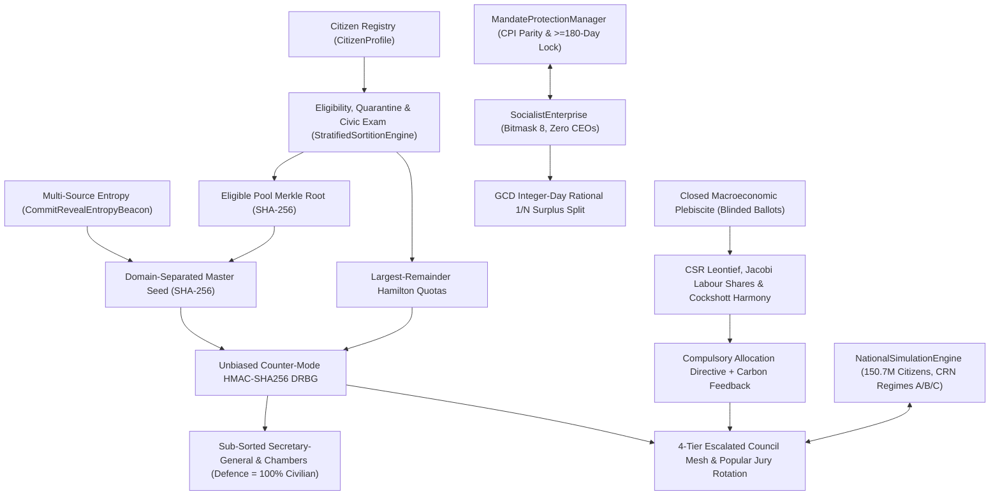

# 04. Under the Hood Mechanics

## 1. End-to-End Subsystem Data Flow (Mermaid Diagram)

---

## 2. Cryptographic Sortition, Quarantine & Civic Enablement (`sortition.py`, `civic_exam.py`)

### 2.1 Deterministic Merkle Tree (`compute_merkle_root`)
1. Deduplicate and lexicographically sort eligible citizen IDs $c_1 < c_2 < \dots < c_m$ (empty pool returns `SHA256("EMPTY_ELIGIBLE_POOL")`).
2. Compute leaf digests $h_{0,k} = \text{SHA256}(c_k)$ and reduce pairwise up the binary tree (duplicating odd trailing nodes) to a 256-bit root $R_{\text{Merkle}}$.

### 2.2 Multi-Source Commit–Reveal (`CommitRevealEntropyBeacon`)
1. **Commit:** $M \ge 2$ independent sources publish $C_s = \text{SHA256}(\text{seed}_s \parallel \texttt{"||"} \parallel \text{nonce}_s)$ prior to beacon lock.
2. **Reveal:** Verified in constant time via `hmac.compare_digest`.
3. **Master Seed:** Binds $R_{\text{Merkle}}$, scope, and cycle inside `SHA256("CIBERSOC_SORTITION_V2|" || scope || "|" || t || "|" || R_Merkle || ...)`, preventing post-commitment pool tampering.

### 2.3 Rejection-Sampled DRBG & Hamilton Quotas
- **`CounterModeHmacDrbg`:** Extracts 64-bit blocks from `HMAC-SHA256(S_master, counter_be)` and rejects values $\ge 2^{64} - (2^{64} \bmod B)$, guaranteeing strictly uniform sampling without modulo bias.
- **`allocate_proportional_hamilton_quotas`:** Computes exact integer floor seats $\lfloor P_s S / P_{\text{total}} \rfloor$ and distributes remainders by $(-r_s, s)$ without floating-point error.
- **Compulsory Quarantine & Civic Enablement (`CivicExamScheduler`):** Outgoing councillors enter `_quarantined_until_cycle` ($C_t \cap C_{t+1} = \emptyset$). `CitizenExamRecord` evaluates exact statutory age exemption ($\ge 60$ years checked prior to attempt history) and tracks 4-subject compliance (`>= 60%`) plus technical-audit qualification (`>= 70%`).

---

## 3. Council Mesh, Popular Jury Rotation & Civilian Multi-Sig (`councils.py`)

- **Escalated Topology & Proportionality:** `EscalatedCouncilMesh` enforces `SECTORAL -> MUNICIPAL -> STATE -> FEDERAL -> None` and restricts `DEFENCE` to the Federal tier. `FederatedSeatProportionality` maintains $1:1$ municipal-to-sectoral seat parity (`20 = 10 + 10`).
- **Logistical `SecretaryGeneral`:** Enforces `self.voting_weight == 1` in `authenticate_resolution` and rejects any veto or unilateral decree (`AutocraticActForbiddenError`).
- **Per-Case Odd-Bench Jury Rotation:** When a Justice chamber has an even number of sorted citizens (e.g. `4`), `active_popular_jury_bench(case_id)` derives a deterministic `CounterModeHmacDrbg` seed from `(council_id, cycle, case_id)` to rotate which alternate sits out, forming an unbiased odd-numbered citizen bench while rejecting professional magistrate substitution (`JudicialOligarchyForbiddenError`).
- **`CivilianMilitaryCommandGate`:** Requires a registered general, sorted civilian Defence minister signature, Federal Secretary-General certification, and $\ge \lceil 2/3 \cdot |D| \rceil$ civilian Defence Chamber co-signatures.

---

## 4. Rational Fixed-Point Enterprise Accounting (`enterprise.py`)

1. **Usufruct Bitmask:** `PropertyRightsBitmask` permits only `[Use=True, Sell=False, Buy=False, Inherit=False]` (`state_code = 8`).
2. **Exact Integer-Day Rational Division:** `distribute_period_profit` sums worked integer days $T = \sum_w d_w$, reduces each worker's fraction by $g_w = \gcd(d_w, T)$, and quantises once with `ROUND_DOWN`:
   $$s_w = \left\lfloor \frac{\Pi_{\text{net}} \cdot (d_w / g_w)}{T / g_w} \right\rfloor_{0.01}, \qquad r_{\text{next}} = \Pi_{\text{net}} - \sum_w s_w$$
   satisfying $0 \le r_{\text{next}} < N_{\text{active}} \cdot 0.01$ with corporate retention identically `Decimal("0.00")`.

---

## 5. Sparse Leontief–Cockshott Solvers & Labour-Share Conservation (`cybernetics.py`)

1. **CSR Sparse Matrix & Hawkins–Simon Check:** `CompressedSparseRowMatrix` computes $\mathbf{A}\mathbf{x}$ and $\mathbf{H}\mathbf{A}$ in $O(\text{nnz}(\mathbf{A}))$; `estimate_spectral_radius` verifies $\rho(\mathbf{A}) < 1$.
2. **Labour-Share Demand Derivation:** `derive_final_demand_from_labour_shares` maps voted shares $s_j$ ($\sum_j s_j = 100$) and Jacobi embedded-labour values $\mathbf{H}$ to $y_j^* = \frac{(s_j / 100) L_{\text{total}}}{H_j}$, ensuring `compute_embedded_labour_shares_pct(y*, H)` recovers $s_j$ identically and $\mathbf{H}\cdot\mathbf{y}^* \equiv \mathbf{l}\cdot\mathbf{x}$.
3. **Harmony Relaxation & Carbon Boundary:** `relax_short_run_capacity_harmony` equilibrates asymmetric Cockshott Harmony within $[\mathbf{0}, \mathbf{x}_{\max}]$, while `InteractiveCyberneticPlanState.iterate_plan_adjustment` adjusts targets by clearing ratios and enforces physical carbon ceilings.

---

## 6. SEEM Common-Random-Numbers (CRN) Counterfactual Engine (`simulation/engine.py`)

- **150.7M Citizens & Inter-Regional Corridors:** Models 10 Brazilian regional poles connected by `INTER_REGIONAL_CORRIDORS` input–output trade flows, cryptographic `CounterModeHmacDrbg` regional councillor sortition (`CouncillorSlot`) with 1-cycle post-mandate quarantine, and portfolio-matched shock mitigation (`PORTFOLIO_EVENT_CATEGORIES`).
- **CRN Institutional Regimes:** `NationalSimulationEngine` advances **(A) `CIBERSOC_DEMARCHY`**, **(B) `ELECTORAL_OLIGARCHY`**, and **(C) `BUREAUCRATIC_CENTRALISM`** over identical exogenous shock streams (`compare_regimes()`), isolating structural differences in HDI convergence, convergent Gini dynamics, and employment resilience.

---

## 7. Reactive `i18n`, Mermaid Rendering & Clean-Code Audit (`translator.py`, `markdown_renderer.py`, `audit.py`)

- **`LocalizationCatalog`:** Enforces exact key-set symmetry across `en_GB.json`, `pt.json`, and `es.json`.
- **`markdown_renderer.py`:** Renders fenced `mermaid` flowcharts into styled HTML cards inside `QTextBrowser`.
- **`audit_clean_code_compliance`:** Streams every `.py` file through `tokenize` and `ast.parse`, enforcing zero `#` comments and zero docstrings repository-wide.
