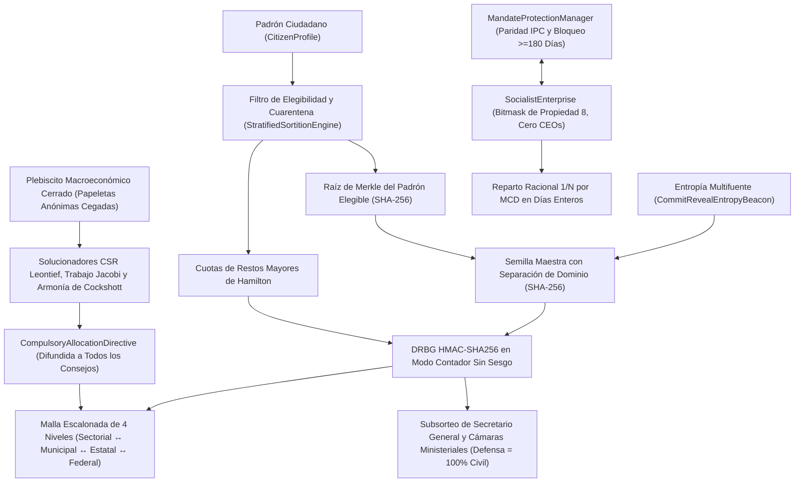

# 04. Mecánica Subyacente (*Under the Hood*)

## 1. Flujo de Datos de Extremo a Extremo entre Subsistemas (Diagrama Mermaid)

El diagrama muestra cada componente principal, sus garantías criptográficas y el flujo de datos desde el padrón ciudadano hasta la directriz de asignación.

---

## 2. Sorteo Criptográfico y Cuarentena Demárquica ([`sortition.py`](../../src/cibersoc/sortition.py))

### 2.1 Árbol Binario Determinista de Merkle (`compute_merkle_root`)
Dado el conjunto de identificadores ciudadanos elegibles $E_t$ para el ciclo $t$:
1. Los identificadores se deduplican y ordenan lexicográficamente: $(c_1 < c_2 < \dots < c_m)$. Si $E_t = \emptyset$, devuelve $\text{SHA256}(\texttt{"EMPTY\_ELIGIBLE\_POOL"})$.
2. Los resúmenes hoja se calculan como $h_{0,k} = \text{SHA256}(c_k)$.
3. En cada nivel del árbol, si la lista posee longitud impar, el último resumen se duplica; los pares adyacentes se concatenan y reducen vía $h_{\ell+1, j} = \text{SHA256}(h_{\ell, 2j} \parallel h_{\ell, 2j+1})$ hasta obtener una única raíz hexadecimal de 256 bits $R_{\text{Merkle}}$. Cualquier adición, omisión o sustitución de un solo ciudadano altera $R_{\text{Merkle}}$ con probabilidad $1 - 2^{-256}$.

### 2.2 Protocolo Multifuente Commit-Reveal (`CommitRevealEntropyBeacon`)
Para impedir que una sola autoridad sesgue la selección aleatoria:
1. **Fase de Compromiso (*Commit*):** Al menos $M \ge 2$ (por defecto $M = 3$) instituciones independientes publican compromisos $C_s = \text{SHA256}(\text{seed}_s \parallel \texttt{"||"} \parallel \text{nonce}_s)$ antes del bloqueo (`_is_locked = True`).
2. **Fase de Revelación (*Reveal*):** Tras el bloqueo, cada fuente revela $(\text{seed}_s, \text{nonce}_s)$, verificados en tiempo constante mediante `hmac.compare_digest` frente a ataques de canal lateral por tiempo.
3. **Derivación de la Semilla Maestra:** Las fuentes se ordenan lexicográficamente por `source_id` y se combinan con el ámbito, ciclo y raíz de Merkle:
   $$S_{\text{master}} = \text{SHA256}\left(\texttt{"CIBERSOC\_SORTITION\_V2|"} \parallel \text{scope} \parallel \texttt{"|"} \parallel t \parallel \texttt{"|"} \parallel R_{\text{Merkle}} \parallel \big\|_{s} (\texttt{"|"} \parallel s \parallel \texttt{":"} \parallel \text{seed}_s \parallel \texttt{":"} \parallel \text{nonce}_s)\right)$$
   Vincular $R_{\text{Merkle}}$ dentro de $S_{\text{master}}$ hace matemáticamente imposible alterar el padrón elegible *después* de observar los compromisos de entropía.

### 2.3 DRBG en Modo Contador Sin Sesgo de Módulo (`CounterModeHmacDrbg`)
La reducción modular simple (`rand64() % B`) introduce sesgo estadístico cuando $B$ no divide a $2^{64}$. `CounterModeHmacDrbg` extrae enteros de 64 bits de los primeros 8 bytes de $\text{HMAC-SHA256}(K = S_{\text{master}}, \text{counter}_{64\text{-be}})$ y calcula el umbral exacto de rechazo:
$$L = 2^{64} - (2^{64} \bmod B)$$
Los candidatos $u \ge L$ se descartan; los candidatos aceptados $u < L$ están **estrictamente distribuidos de forma uniforme** sobre $\{0, 1, \dots, B-1\}$. `sample_without_replacement` ejecuta una permutación parcial determinista de Fisher–Yates sobre el estrato ordenado en $O(k)$ intercambios.

### 2.4 Estratificación Proporcional (`allocate_proportional_hamilton_quotas`)
Dados estratos demográficos/ocupacionales no vacíos con poblaciones $P_s > 0$ ($\sum_s P_s = P_{\text{total}}$) y $S \le P_{\text{total}}$ escaños:
1. Se calculan cuotas enteras inferiores y restos exactos sin aritmética de coma flotante:
   $$q_s^{\text{floor}} = \left\lfloor \frac{P_s \cdot S}{P_{\text{total}}} \right\rfloor, \qquad r_s = (P_s \cdot S) \bmod P_{\text{total}}$$
2. Los estratos vacíos ($P_s = 0$) se excluyen del desempate de restos para no recibir jamás escaños.
3. Los $S - \sum_s q_s^{\text{floor}}$ escaños restantes se adjudican por orden decreciente de $(-r_s, s)$. Dado que $q_s^{\text{floor}} \le P_s - 1$ siempre que $S < P_{\text{total}}$ y $P_s \ge 1$, la cuota final cumple $q_s \le P_s$ incondicionalmente.

### 2.5 Cuarentena Obligatoria y Subsorteo de Funciones con Supremacía Civil
* **Invariante de Cuarentena:** Al invocar `register_mandate_completion(citizen_ids, completed_cycle=t)`, cada consejero saliente se retira de `_serving_councillor_ids` y se registra en `_quarantined_until_cycle[cid] = max(prev, t + cooldown_cycles)`. `is_eligible(cid, t')` devuelve `False` para todo $t' \le t + \text{cooldown\_cycles}$, garantizando $C_t \cap C_{t+1} = \emptyset$.
* **Subsorteo Interno (`assign_internal_roles`):** Deriva una semilla secundaria $\text{SHA256}(\texttt{"INTERNAL\_ROLES|"} \parallel S_{\text{master}})$, baraja a los sorteados, asigna el índice `0` al `SecretaryGeneral` logístico, filtra primero `not is_military_personnel` al cubrir `MinistryPortfolio.DEFENCE` (lanzando `CivilianSupremacyViolationError` si no existe ningún civil), adjudica titulares a las seis carteras restantes y redirige cualquier militar sobrante fuera de Defensa hacia carteras técnicas civiles.
* **Verificación Pública Zero-Trust (`verify_audit_proof`):** Comprueba de forma independiente (1) unicidad de elegibles, (2) selección acotada no vacía, (3) $\ge 2$ compromisos, (4) igualdad de la raíz de Merkle, (5) correspondencia exacta entre compromisos y revelaciones, (6) cada resumen SHA-256 de compromiso, (7) derivación de la semilla maestra, (8) cuotas de Hamilton y (9) repetición íntegra del DRBG.

---

## 3. Malla de Consejos y Compuerta Civil Multifirma ([`councils.py`](../../src/cibersoc/councils.py))

* **Topología Escalonada:** `EscalatedCouncilMesh.EXPECTED_PARENT_TIER` impone `SECTORAL -> MUNICIPAL -> STATE -> FEDERAL -> None` y prohíbe `MinistryPortfolio.DEFENCE` fuera del nivel `FEDERAL`.
* **Proporcionalidad Federativa de Escaños (`FederatedSeatProportionality`):** Modela la composición analítica de los consejos con paridad directa $N_{\text{municipal}} = \lambda_{\text{mun}} \sum_{s \in \mathcal{S}(M)} N(s)$ ($\lambda_{\text{mun}} = 1.0$, $20$ escaños en Curitiba estrictamente proporcionales a los $10 + 10 = 20$ consejeros sectoriales de Boqueirão y Matriz). Garantiza una bancada de $4$ jurados en Justicia (asegurando el quórum de $\ge 3$ en el jurado popular) y limita la cámara a $20$ miembros para preservar la eficacia deliberativa y evitar el agotamiento de la cuarentena poblacional.
* **`SecretaryGeneral` Logístico:** `order_meeting_agenda` ordena determinísticamente por `(-urgency_level, submission_sequence, item_id)`. `authenticate_resolution` verifica que todos los votantes pertenezcan a `valid_member_ids` y que `votes_in_favour >= (N // 2) + 1` antes de emitir el hash SHA-256 de la resolución; `attempt_veto` y `attempt_unilateral_decree` lanzan incondicionalmente `AutocraticActForbiddenError`.
* **`CivilianMilitaryCommandGate`:** Rechaza cualquier ministro militar o miembro militar en la Cámara de Defensa desde su instanciación. `issue_strategic_order` exige: (a) general registrado, (b) firma del ministro civil sorteado, (c) certificación de acta por el Secretario General Federal y (d) aprobación de al menos $\max(1, \lfloor (2|D| + 2)/3 \rfloor) = \lceil \frac{2}{3}|D| \rceil$ civiles sorteados de la Cámara de Defensa.

---

## 4. Contabilidad Empresarial Racional en Coma Fija ([`enterprise.py`](../../src/cibersoc/enterprise.py))

1. **Máscara de Bits de Propiedad:** `PropertyRightsBitmask.state_code` evalúa `(use << 3) | (sell << 2) | (buy << 1) | inherit`. Únicamente `[True, False, False, False]` (`8`) supera `assert_socialist_productive_unit()`.
2. **División Racional Exacta por Días Enteros:** La coma flotante y las divisiones decimales intermedias ingenuas (`Decimal(d_w) / Decimal(D)`) sufren deriva por truncamiento de decimales periódicos (p. ej., $7 \times \text{Decimal}(1)/\text{Decimal}(7) = 1.0000000000000000000000000003 > 1$). `SocialistEnterprise.distribute_period_profit` elimina todo redondeo intermedio sumando días enteros trabajados $T = \sum_{w} d_w$, reduciendo cada fracción por $g_w = \gcd(d_w, T)$ y cuantizando una sola vez al final con `ROUND_DOWN`:
   $$s_w = \left\lfloor \frac{\Pi_{\text{net}} \cdot (d_w / g_w)}{T / g_w} \right\rfloor_{0.01}, \qquad r_{\text{next}} = \Pi_{\text{net}} - \sum_{w} s_w$$
   Como $\sum_w \frac{d_w}{T} = 1$ idénticamente sobre $\mathbb{Q}$, se cumple $0.00 \le r_{\text{next}} < N_{\text{active}} \times 0.01$ como invariante matemática estricta, y el beneficio corporativo retenido es idénticamente `Decimal("0.00")`.

---

## 5. Matriz Dispersa Insumo-Producto, Valores-Trabajo y Armonía ([`cybernetics.py`](../../src/cibersoc/cybernetics.py))

1. **`CompressedSparseRowMatrix`:** Almacena únicamente coeficientes técnicos no nulos ($|a_{ij}| > 10^{-15}$) en tres vectores contiguos (`values`, `column_indices`, `row_pointers`), ejecutando multiplicación columna $\mathbf{A}\mathbf{x}$ y fila $\mathbf{H}\mathbf{A}$ en tiempo $O(\text{nnz}(\mathbf{A}))$.
2. **Condição Espectral de Hawkins–Simon:** `estimate_spectral_radius` aplica iteración de potencias normalizada para comprobar $\rho(\mathbf{A}) < 1$, garantizando que $(\mathbf{I}-\mathbf{A})^{-1} = \sum_{k=0}^{\infty} \mathbf{A}^k \ge \mathbf{0}$ existe y es no negativa.
3. **Producción Bruta Gauss–Seidel y Trabajo Incorporado Jacobi:**
   * `solve_leontief_gross_output_gauss_seidel` itera $x_i^{(k+1)} = y_i + \sum_{j < i} a_{ij} x_j^{(k+1)} + \sum_{j \ge i} a_{ij} x_j^{(k)}$ hasta variación relativa $< 10^{-8}$.
   * `compute_embedded_labour_hours_jacobi` itera $\mathbf{H}^{(k+1)} = \mathbf{l} + \mathbf{H}^{(k)}\mathbf{A}$, satisfaciendo la identidad de conservación de Marx–Leontief–Cockshott $\mathbf{H} \cdot \mathbf{y} \equiv \mathbf{l} \cdot \mathbf{x}$.
4. **Relajación de Armonía a Corto Plazo (`relax_short_run_capacity_harmony`):** Escala la producción inicial a la caja factible $[\mathbf{0}, \mathbf{x}_{\max}]$ y ajusta iterativamente $x_i$ proporcionalmente a $(\bar{H} - H(u_i))$ con recocido lineal y cota de producto neto no negativo $x_i \ge (\mathbf{A}\mathbf{x})_i$.
5. **Urna Cegada Resistente a Coacción:** `cast_anonymous_ballot` proyecta `unlinkable_voter_token` en `blinded_slot = SHA256(plebiscite_id || "||" || token)`, permitiendo que el votante bajo presión externa sobrescriba en secreto su papeleta previa manteniendo el escrutinio de un ciudadano, un voto.

---

## 6. `i18n` Reactiva y Verificación de Clean Code ([`translator.py`](../../src/cibersoc/i18n/translator.py), [`audit.py`](../../src/cibersoc/audit.py))

* **`LocalizationCatalog`:** Carga `en_GB.json`, `pt.json` y `es.json` al iniciar, exige igualdad estricta de conjuntos de claves entre los tres idiomas en `_verify_key_symmetry` y notifica a los oyentes de la UI al invocar `switch_locale`.
* **`audit_clean_code_compliance`:** Procesa todos los archivos `.py` del repositorio con el analizador léxico estándar `tokenize` (rechazando cualquier token `tokenize.COMMENT`) y con `ast.parse` (rechazando cualquier docstring `ast.Expr(ast.Constant(str))` en módulos, clases o funciones), garantizando un código fuente 100% autoexplicativo sin muletas textuales.

---

## 7. Síntesis de Referencia Rápida
- **Criptografía determinista** garantiza que el padrón elegible no puede alterarse tras los compromisos de entropía.
- **DRBG sin sesgo** proporciona muestreo aleatorio uniforme para el sorteo.
- **Cuotas de Hamilton** asignan escaños proporcionalmente sin errores de coma flotante.
- **Cuarentena** garantiza que ningún consejero sirva en dos ciclos consecutivos.
- **Excedente empresarial** se divide con exactitud usando aritmética racional de días enteros.
- **Solucionadores de Leontief y Armonía** se ejecutan en tiempo $O(\text{nnz})$ disperso con convergencia demostrable.
- **`i18n`** se conmuta en vivo con coste cero de reinicio.
- **Auditoría de Clean Code** garantiza código fuente sin comentarios ni docstrings como invariante del proyecto.

*Todos los mecanismos anteriores trabajan conjuntamente para ofrecer una plataforma de simulación matemáticamente demostrable, transparente y socialmente equitativa.*
