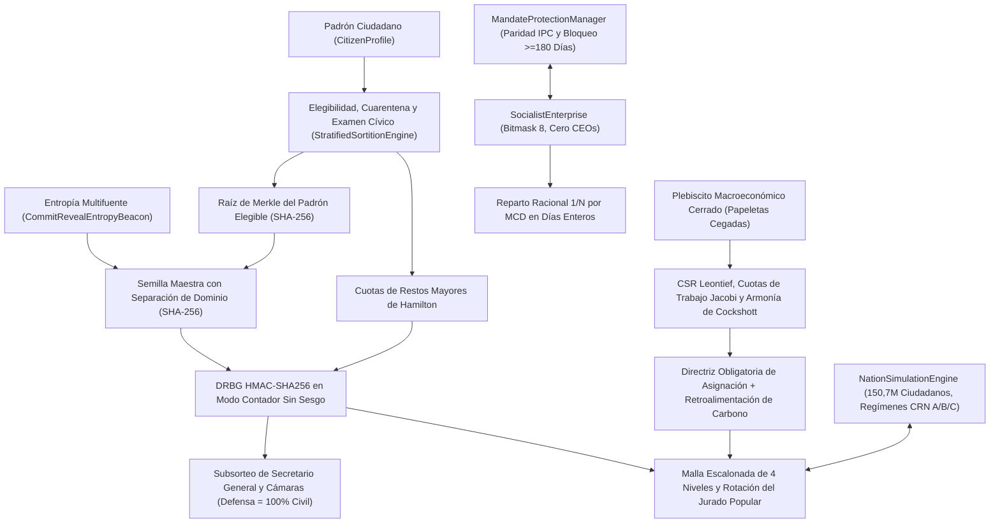

# 04. Mecánica Subyacente (*Under the Hood*)

## 1. Flujo de Datos de Extremo a Extremo entre Subsistemas (Diagrama Mermaid)

---

## 2. Sorteo Criptográfico, Cuarentena y Habilitación Cívica ([`sortition.py`](../../src/cibersoc/sortition.py), [`civic_exam.py`](../../src/cibersoc/civic_exam.py))

### 2.1 Árbol Binario Determinista de Merkle (`compute_merkle_root`)
1. Deduplica y ordena lexicográficamente los identificadores elegibles $c_1 < c_2 < \dots < c_m$ (un padrón vacío devuelve `SHA256("EMPTY_ELIGIBLE_POOL")`).
2. Calcula las hojas $h_{0,k} = \text{SHA256}(c_k)$ y reduce pares adyacentes hasta una única raíz de 256 bits $R_{\text{Merkle}}$.

### 2.2 Protocolo Multifuente Commit–Reveal (`CommitRevealEntropyBeacon`)
1. **Commit:** $M \ge 2$ fuentes independientes publican $C_s = \text{SHA256}(\text{seed}_s \parallel \texttt{"||"} \parallel \text{nonce}_s)$ antes del bloqueo.
2. **Reveal:** Verificado en tiempo constante mediante `hmac.compare_digest`.
3. **Semilla Maestra:** Vincula $R_{\text{Merkle}}$, ámbito y ciclo dentro de `SHA256("CIBERSOC_SORTITION_V2|" || scope || "|" || t || "|" || R_Merkle || ...)`, impidiendo manipulaciones poscompromiso.

### 2.3 DRBG por Muestreo con Rechazo y Cuotas de Hamilton
- **`CounterModeHmacDrbg`:** Extrae bloques de 64 bits de `HMAC-SHA256(S_master, counter_be)` y descarta valores $\ge 2^{64} - (2^{64} \bmod B)$, garantizando distribución estrictamente uniforme sin sesgo modular.
- **`allocate_proportional_hamilton_quotas`:** Calcula cuotas enteras $\lfloor P_s S / P_{\text{total}} \rfloor$ y reparte restos por $(-r_s, s)$ sin coma flotante.
- **Cuarentena Obligatoria y Examen Cívico (`CivicExamScheduler`):** Los consejeros salientes ingresan en `_quarantined_until_cycle` ($C_t \cap C_{t+1} = \emptyset$). `CitizenExamRecord` evalúa en primer lugar la exención estatutaria por edad ($\ge 60$ años incluso sin convocatorias previas) y registra tanto la habilitación ordinaria (`>= 60%`) como la cualificación para auditoría técnica (`>= 70%`).

---

## 3. Malla de Consejos, Rotación del Jurado Popular y Compuerta Civil ([`councils.py`](../../src/cibersoc/councils.py))

- **Topología Escalonada y Proporcionalidad:** `EscalatedCouncilMesh` impone `SECTORAL -> MUNICIPAL -> STATE -> FEDERAL -> None` y restringe `DEFENCE` al ámbito Federal. `FederatedSeatProportionality` mantiene paridad $1:1$ municipal/sectorial (`20 = 10 + 10`).
- **`SecretaryGeneral` Logístico:** Exige `self.voting_weight == 1` en `authenticate_resolution` y bloquea todo intento de veto o decreto (`AutocraticActForbiddenError`).
- **Rotación Determinista de la Bancada Impar del Jurado Popular:** Cuando la Cámara de Justicia cuenta con un número par de ciudadanos sorteados (p. ej., `4`), `active_popular_jury_bench(case_id)` deriva una semilla `CounterModeHmacDrbg` de `(council_id, cycle, case_id)` para alternar imparcialmente al suplente excluido, conformando una bancada impar y prohibiendo su sustitución por jueces de carrera (`JudicialOligarchyForbiddenError`).
- **`CivilianMilitaryCommandGate`:** Exige general registrado, firma del ministro civil sorteado, certificación del Secretario General Federal y $\ge \lceil 2/3 \cdot |D| \rceil$ cofirmas civiles en la Cámara de Defensa.

---

## 4. Contabilidad Empresarial Racional en Coma Fija ([`enterprise.py`](../../src/cibersoc/enterprise.py))

1. **Máscara de Bits de Usufructo:** `PropertyRightsBitmask` admite exclusivamente `[Use=True, Sell=False, Buy=False, Inherit=False]` (`state_code = 8`).
2. **División Racional Exacta por Días Enteros:** `distribute_period_profit` suma días enteros trabajados $T = \sum_w d_w$, reduce cada fracción por $g_w = \gcd(d_w, T)$ y cuantiza una sola vez con `ROUND_DOWN`:
   $$s_w = \left\lfloor \frac{\Pi_{\text{net}} \cdot (d_w / g_w)}{T / g_w} \right\rfloor_{0.01}, \qquad r_{\text{next}} = \Pi_{\text{net}} - \sum_w s_w$$
   verificando $0 \le r_{\text{next}} < N_{\text{active}} \cdot 0{,}01$ con beneficio corporativo retenido idénticamente `Decimal("0.00")`.

---

## 5. Solucionadores Dispersos Leontief–Cockshott y Conservación de Cuotas de Trabajo ([`cybernetics.py`](../../src/cibersoc/cybernetics.py))

1. **Matriz Dispersa CSR y Condición de Hawkins–Simon:** `CompressedSparseRowMatrix` calcula $\mathbf{A}\mathbf{x}$ y $\mathbf{H}\mathbf{A}$ en $O(\text{nnz}(\mathbf{A}))$; `estimate_spectral_radius` comprueba $\rho(\mathbf{A}) < 1$.
2. **Derivación de la Demanda por Cuotas de Trabajo:** `derive_final_demand_from_labour_shares` proyecta las cuotas votadas $s_j$ ($\sum_j s_j = 100$) y los valores-trabajo de Jacobi $\mathbf{H}$ en $y_j^* = \frac{(s_j / 100) L_{\text{total}}}{H_j}$, garantizando que `compute_embedded_labour_shares_pct(y*, H)` recupere $s_j$ idénticamente y que $\mathbf{H}\cdot\mathbf{y}^* \equiv \mathbf{l}\cdot\mathbf{x}$.
3. **Relajación de Armonía y Frontera de Carbono:** `relax_short_run_capacity_harmony` equilibra la Armonía asimétrica de Cockshott en $[\mathbf{0}, \mathbf{x}_{\max}]$, mientras `InteractiveCyberneticPlanState.iterate_plan_adjustment` ajusta metas por vaciado e impone el techo ecológico de carbono.

---

## 6. Motor Contrafactual SEEM por Números Aleatorios Comunes ([`simulation/engine.py`](../../src/cibersoc/simulation/engine.py))

- **150,7 Millones de Ciudadanos y Corredores Interregionales:** Modela 10 polos macrorregionales brasileños conectados por flujos insumo-producto (`INTER_REGIONAL_CORRIDORS`), sorteo criptográfico `CounterModeHmacDrbg` de consejeros regionales (`CouncillorSlot`) con cuarentena posmandato y mitigación sectorial de choques (`PORTFOLIO_EVENT_CATEGORIES`).
- **Regímenes Institucionales bajo CRN (`_apply_institutional_governance`):** `NationSimulationEngine` evoluciona **(A) `CIBERSOC_DEMARCHY`**, **(B) `ELECTORAL_OLIGARCHY`** y **(C) `BUREAUCRATIC_CENTRALISM`** bajo idéntica secuencia de choques exógenos (`compare_regimes()`). Cada ciclo anual aplica convergencia asintótica parametrizada (`convergence_rate`), transferencia interregional (`equalisation_transfer`: `+0.032` en A, `+0.014` en C, `-0.005` polarización en B), osificación burocrática tras el Año 8 (`ossification_rate = 0.0018` en C), arrastre climático persistente en biomas tropicales ($\text{lat} > -16^\circ$ bajo `ECOLOGICAL_STRESS`), aceleración reconstructiva (`1.25×` bajo `POST_CRISIS_EQUALISATION`) y margen cóncavo de frontera (`max(0, 0.965 - hdi)`) para directrices plebiscitarias.

---

## 7. `i18n` Reactiva, Diagramas Mermaid y Auditoría de Clean Code (`translator.py`, `markdown_renderer.py`, `audit.py`)

- **`LocalizationCatalog`:** Exige igualdad estricta de claves entre `en_GB.json`, `pt.json` y `es.json`.
- **`markdown_renderer.py`:** Convierte bloques `mermaid` en diagramas HTML estilizados dentro de `QTextBrowser`.
- **`audit_clean_code_compliance`:** Procesa todos los archivos `.py` mediante `tokenize` y `ast.parse`, exigiendo cero comentarios `#` y cero docstrings en todo el repositorio.
