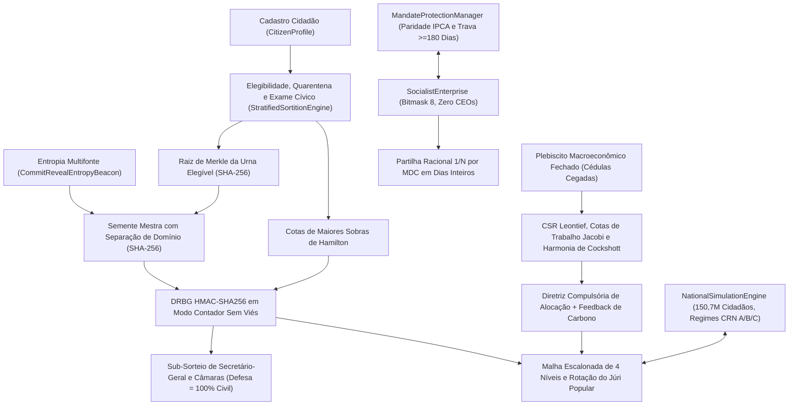

# 04. Mecânica Subjacente (*Under the Hood*)

## 1. Fluxo de Dados Ponta a Ponta entre Subsistemas (Diagrama Mermaid)

---

## 2. Sorteio Criptográfico, Quarentena e Habilitação Cívica ([`sortition.py`](../../src/cibersoc/sortition.py), [`civic_exam.py`](../../src/cibersoc/civic_exam.py))

### 2.1 Árvore Binária Determinística de Merkle (`compute_merkle_root`)
1. Deduplica e ordena lexicograficamente os identificadores elegíveis $c_1 < c_2 < \dots < c_m$ (urna vazia retorna `SHA256("EMPTY_ELIGIBLE_POOL")`).
2. Calcula as folhas $h_{0,k} = \text{SHA256}(c_k)$ e reduz pares adjacentes até uma única raiz de 256 bits $R_{\text{Merkle}}$.

### 2.2 Protocolo Multifonte Commit–Reveal (`CommitRevealEntropyBeacon`)
1. **Commit:** $M \ge 2$ fontes independentes publicam $C_s = \text{SHA256}(\text{seed}_s \parallel \texttt{"||"} \parallel \text{nonce}_s)$ antes do travamento.
2. **Reveal:** Validado em tempo constante por `hmac.compare_digest`.
3. **Semente Mestra:** Vincula $R_{\text{Merkle}}$, escopo e ciclo dentro de `SHA256("CIBERSOC_SORTITION_V2|" || scope || "|" || t || "|" || R_Merkle || ...)`, impedindo adulteração pós-compromisso.

### 2.3 DRBG por Amostragem com Rejeição e Cotas de Hamilton
- **`CounterModeHmacDrbg`:** Extrai blocos de 64 bits de `HMAC-SHA256(S_master, counter_be)` e descarta valores $\ge 2^{64} - (2^{64} \bmod B)$, garantindo distribuição estritamente uniforme sem viés de módulo.
- **`allocate_proportional_hamilton_quotas`:** Calcula cotas inteiras $\lfloor P_s S / P_{\text{total}} \rfloor$ e distribui sobras por $(-r_s, s)$ sem ponto flutuante.
- **Quarentena Compulsória e Exame Cívico (`CivicExamScheduler`):** Conselheiros cessantes ingressam em `_quarantined_until_cycle` ($C_t \cap C_{t+1} = \emptyset$). `CitizenExamRecord` avalia primeiro a isenção estatutária por idade ($\ge 60$ anos mesmo sem provas anteriores) e acompanha habilitação regular (`>= 60%`) e qualificação para auditoria técnica (`>= 70%`).

---

## 3. Malha de Conselhos, Rotação do Júri Popular e Trava Civil ([`councils.py`](../../src/cibersoc/councils.py))

- **Topologia Escalonada e Proporcionalidade:** `EscalatedCouncilMesh` impõe `SECTORAL -> MUNICIPAL -> STATE -> FEDERAL -> None` e restringe `DEFENCE` à esfera Federal. `FederatedSeatProportionality` mantém paridade $1:1$ municipal/setorial (`20 = 10 + 10`).
- **`SecretaryGeneral` Logístico:** Impõe `self.voting_weight == 1` em `authenticate_resolution` e bloqueia qualquer tentativa de veto ou decreto (`AutocraticActForbiddenError`).
- **Rotação Determinística da Bancada Ímpar do Júri Popular:** Quando a Câmara de Justiça possui número par de cidadãos sorteados (ex.: `4`), `active_popular_jury_bench(case_id)` deriva uma semente `CounterModeHmacDrbg` de `(council_id, cycle, case_id)` para alternar imparcialmente o suplente excluído, compondo bancada ímpar e vedando substituição por juiz de carreira (`JudicialOligarchyForbiddenError`).
- **`CivilianMilitaryCommandGate`:** Exige general cadastrado, assinatura do ministro civil sorteado, certificação do Secretário-Geral Federal e $\ge \lceil 2/3 \cdot |D| \rceil$ coassinaturas civis na Câmara de Defesa.

---

## 4. Contabilidade Empresarial Racional em Ponto Fixo ([`enterprise.py`](../../src/cibersoc/enterprise.py))

1. **Máscara de Bits de Usufruto:** `PropertyRightsBitmask` admite exclusivamente `[Use=True, Sell=False, Buy=False, Inherit=False]` (`state_code = 8`).
2. **Divisão Racional Exata por Dias Inteiros:** `distribute_period_profit` soma dias inteiros trabalhados $T = \sum_w d_w$, reduz cada fração por $g_w = \gcd(d_w, T)$ e quantiza uma única vez com `ROUND_DOWN`:
   $$s_w = \left\lfloor \frac{\Pi_{\text{net}} \cdot (d_w / g_w)}{T / g_w} \right\rfloor_{0.01}, \qquad r_{\text{next}} = \Pi_{\text{net}} - \sum_w s_w$$
   cumprindo $0 \le r_{\text{next}} < N_{\text{active}} \cdot 0{,}01$ e mantendo retenção corporativa identicamente `Decimal("0.00")`.

---

## 5. Solucionadores Esparsos Leontief–Cockshott e Conservação de Cotas de Trabalho ([`cybernetics.py`](../../src/cibersoc/cybernetics.py))

1. **Matriz Esparsa CSR e Condição de Hawkins–Simon:** `CompressedSparseRowMatrix` calcula $\mathbf{A}\mathbf{x}$ e $\mathbf{H}\mathbf{A}$ em $O(\text{nnz}(\mathbf{A}))$; `estimate_spectral_radius` atesta $\rho(\mathbf{A}) < 1$.
2. **Derivação da Demanda por Cotas de Trabalho:** `derive_final_demand_from_labour_shares` projeta as cotas votadas $s_j$ ($\sum_j s_j = 100$) e os valores-trabalho de Jacobi $\mathbf{H}$ em $y_j^* = \frac{(s_j / 100) L_{\text{total}}}{H_j}$, garantindo que `compute_embedded_labour_shares_pct(y*, H)` recupere $s_j$ identicamente e que $\mathbf{H}\cdot\mathbf{y}^* \equiv \mathbf{l}\cdot\mathbf{x}$.
3. **Relaxação de Harmonia e Fronteira de Carbono:** `relax_short_run_capacity_harmony` equilibra a Harmonia assimétrica de Cockshott em $[\mathbf{0}, \mathbf{x}_{\max}]$, enquanto `InteractiveCyberneticPlanState.iterate_plan_adjustment` ajusta metas por escoamento e impõe o teto ecológico de carbono.

---

## 6. Motor Contrafactual SEEM por Números Aleatórios Comuns ([`simulation/engine.py`](../../src/cibersoc/simulation/engine.py))

- **150,7 Milhões de Cidadãos e Corredores Inter-Regionais:** Modela 10 polos macrorregionais brasileiros conectados por fluxos insumo-produto (`INTER_REGIONAL_CORRIDORS`), sorteio criptográfico `CounterModeHmacDrbg` de conselheiros regionais (`CouncillorSlot`) com quarentena pós-mandato e mitigação setorial de choques (`PORTFOLIO_EVENT_CATEGORIES`).
- **Regimes Institucionais sob CRN:** `NationalSimulationEngine` evolui **(A) `CIBERSOC_DEMARCHY`**, **(B) `ELECTORAL_OLIGARCHY`** e **(C) `BUREAUCRATIC_CENTRALISM`** sob a mesma sequência de choques exógenos (`compare_regimes()`), isolando diferenças estruturais em IDH, convergência do índice de Gini e resiliência do emprego.

---

## 7. `i18n` Reativa, Diagramas Mermaid e Auditoria de Clean Code (`translator.py`, `markdown_renderer.py`, `audit.py`)

- **`LocalizationCatalog`:** Impõe igualdade estrita de chaves entre `en_GB.json`, `pt.json` e `es.json`.
- **`markdown_renderer.py`:** Converte blocos `mermaid` em fluxogramas HTML estilizados dentro do `QTextBrowser`.
- **`audit_clean_code_compliance`:** Inspeciona todos os arquivos `.py` via `tokenize` e `ast.parse`, exigindo zero comentários `#` e zero docstrings em todo o repositório.
