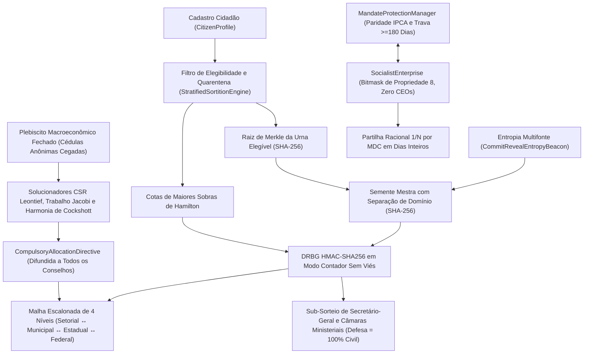

# 04. Mecânica Subjacente (*Under the Hood*)

## 1. Fluxo de Dados Ponta a Ponta entre Subsistemas (Diagrama Mermaid)

O diagrama mostra cada componente principal, suas garantias criptográficas e o fluxo de dados do cadastro cidadão até a diretiva de alocação.

---

## 2. Sorteio Criptográfico e Quarentena Demárquica ([`sortition.py`](../../src/cibersoc/sortition.py))

### 2.1 Árvore Binária Determinística de Merkle (`compute_merkle_root`)
Dado o conjunto de identificadores elegíveis $E_t$ para o ciclo $t$:
1. Os identificadores são deduplicados e ordenados lexicograficamente: $(c_1 < c_2 < \dots < c_m)$. Se $E_t = \emptyset$, retorna-se $\text{SHA256}(\texttt{"EMPTY\_ELIGIBLE\_POOL"})$.
2. As folhas são calculadas por $h_{0,k} = \text{SHA256}(c_k)$.
3. Em cada nível da árvore, caso a lista possua cardinalidade ímpar, duplica-se o último *digest*; pares adjacentes são concatenados e reduzidos via $h_{\ell+1, j} = \text{SHA256}(h_{\ell, 2j} \parallel h_{\ell, 2j+1})$ até restar uma única raiz hexadecimal de 256 bits $R_{\text{Merkle}}$. Qualquer inclusão, omissão ou troca de um único cidadão altera $R_{\text{Merkle}}$ com probabilidade $1 - 2^{-256}$.

### 2.2 Protocolo Multifonte Commit-Reveal (`CommitRevealEntropyBeacon`)
Para impedir que qualquer autoridade isolada manipule a seleção aleatória:
1. **Fase de Compromisso (*Commit*):** Ao menos $M \ge 2$ (padrão $M = 3$) instituições independentes publicam compromissos $C_s = \text{SHA256}(\text{seed}_s \parallel \texttt{"||"} \parallel \text{nonce}_s)$ antes do travamento (`_is_locked = True`).
2. **Fase de Revelação (*Reveal*):** Após o travamento, cada fonte revela $(\text{seed}_s, \text{nonce}_s)$, validados em tempo constante por `hmac.compare_digest` contra ataques temporais (*timing attacks*).
3. **Derivação da Semente Mestra:** As fontes são ordenadas por `source_id` e combinadas ao escopo, ciclo e raiz de Merkle:
   $$S_{\text{master}} = \text{SHA256}\left(\texttt{"CIBERSOC\_SORTITION\_V2|"} \parallel \text{scope} \parallel \texttt{"|"} \parallel t \parallel \texttt{"|"} \parallel R_{\text{Merkle}} \parallel \big\|_{s} (\texttt{"|"} \parallel s \parallel \texttt{":"} \parallel \text{seed}_s \parallel \texttt{":"} \parallel \text{nonce}_s)\right)$$
   Vincular $R_{\text{Merkle}}$ dentro de $S_{\text{master}}$ torna matematicamente impossível adulterar a lista de cidadãos elegíveis *após* observar os compromissos de entropia.

### 2.3 DRBG em Modo Contador Sem Viés de Módulo (`CounterModeHmacDrbg`)
A redução modular ingênua (`rand64() % B`) introduz viés estatístico sempre que $B$ não divide $2^{64}$. `CounterModeHmacDrbg` extrai inteiros de 64 bits dos primeiros 8 bytes de $\text{HMAC-SHA256}(K = S_{\text{master}}, \text{counter}_{64\text{-be}})$ e calcula o limiar exato de rejeição:
$$L = 2^{64} - (2^{64} \bmod B)$$
Candidatos $u \ge L$ são descartados; candidatos aceitos $u < L$ possuem distribuição **estritamente uniforme** sobre $\{0, 1, \dots, B-1\}$. `sample_without_replacement` executa embaralhamento parcial determinístico de Fisher–Yates sobre o estrato ordenado em $O(k)$ permutações.

### 2.4 Estratificação Proporcional (`allocate_proportional_hamilton_quotas`)
Dados estratos demográficos/ocupacionais não vazios com populações $P_s > 0$ ($\sum_s P_s = P_{\text{total}}$) e $S \le P_{\text{total}}$ assentos:
1. Calculam-se cotas inteiras inferiores e restos exatos sem ponto flutuante:
   $$q_s^{\text{floor}} = \left\lfloor \frac{P_s \cdot S}{P_{\text{total}}} \right\rfloor, \qquad r_s = (P_s \cdot S) \bmod P_{\text{total}}$$
2. Estratos vazios ($P_s = 0$) são excluídos do desempate de sobras para jamais receberem assento.
3. Os $S - \sum_s q_s^{\text{floor}}$ assentos restantes são atribuídos por ordem decrescente de $(-r_s, s)$. Como $q_s^{\text{floor}} \le P_s - 1$ sempre que $S < P_{\text{total}}$ e $P_s \ge 1$, a cota resultante satisfaz $q_s \le P_s$ incondicionalmente.

### 2.5 Quarentena Compulsória e Sub-Sorteio de Funções com Supremacia Civil
* **Invariante de Quarentena:** Em `register_mandate_completion(citizen_ids, completed_cycle=t)`, cada conselheiro cessante é removido de `_serving_councillor_ids` e gravado em `_quarantined_until_cycle[cid] = max(prev, t + cooldown_cycles)`. `is_eligible(cid, t')` retorna `False` para todo $t' \le t + \text{cooldown\_cycles}$, garantindo $C_t \cap C_{t+1} = \emptyset$.
* **Sub-Sorteio Interno (`assign_internal_roles`):** Deriva a semente secundária $\text{SHA256}(\texttt{"INTERNAL\_ROLES|"} \parallel S_{\text{master}})$, embaralha os sorteados, designa o índice `0` como `SecretaryGeneral` logístico, filtra primeiro `not is_military_personnel` ao prover `MinistryPortfolio.DEFENCE` (disparando `CivilianSupremacyViolationError` caso inexistam civis), distribui os titulares das demais seis pastas e redireciona eventuais militares remanescentes para fora da Defesa rumo a pastas técnicas civis.
* **Verificação Pública Zero-Trust (`verify_audit_proof`):** Revalida independentemente (1) unicidade dos elegíveis, (2) seleção limitada não vazia, (3) $\ge 2$ compromissos, (4) igualdade da raiz de Merkle, (5) alinhamento exato entre compromissos e revelações, (6) cada *digest* SHA-256 de compromisso, (7) derivação da semente mestra, (8) cotas de Hamilton e (9) reprodução integral do DRBG.

---

## 3. Malha de Conselhos e Trava Civil Multi-Assinatura ([`councils.py`](../../src/cibersoc/councils.py))

* **Topologia Escalonada:** `EscalatedCouncilMesh.EXPECTED_PARENT_TIER` impõe `SECTORAL -> MUNICIPAL -> STATE -> FEDERAL -> None` e proíbe `MinistryPortfolio.DEFENCE` fora da esfera `FEDERAL`.
* **Proporcionalidade Federativa de Vagas (`FederatedSeatProportionality`):** Modela a composição analítica dos conselhos com paridade direta $N_{\text{municipal}} = \lambda_{\text{mun}} \sum_{s \in \mathcal{S}(M)} N(s)$ ($\lambda_{\text{mun}} = 1.0$, $20$ vagas em Curitiba estritamente proporcionais aos $10 + 10 = 20$ conselheiros setoriais de Boqueirão e Matriz). Garante bancada de $4$ jurados na Justiça (assegurando quórum de $\ge 3$ no júri popular) e limita a câmara a $20$ membros para preservar a eficiência deliberativa e evitar a exaustão da quarentena na população.
* **`SecretaryGeneral` Logístico:** `order_meeting_agenda` ordena deterministicamente por `(-urgency_level, submission_sequence, item_id)`. `authenticate_resolution` confere se todos os votantes pertencem a `valid_member_ids` e se `votes_in_favour >= (N // 2) + 1` antes de emitir o hash SHA-256 da resolução; `attempt_veto` e `attempt_unilateral_decree` lançam incondicionalmente `AutocraticActForbiddenError`.
* **`CivilianMilitaryCommandGate`:** Rejeita qualquer ministro militar ou membro militar na Câmara de Defesa já na instanciação. `issue_strategic_order` exige: (a) general cadastrado, (b) assinatura do ministro civil sorteado, (c) certificação de ata pelo Secretário-Geral Federal e (d) aprovação de ao menos $\max(1, \lfloor (2|D| + 2)/3 \rfloor) = \lceil \frac{2}{3}|D| \rceil$ civis sorteados da Câmara de Defesa.

---

## 4. Contabilidade Empresarial Racional em Ponto Fixo ([`enterprise.py`](../../src/cibersoc/enterprise.py))

1. **Máscara de Bits de Propriedade:** `PropertyRightsBitmask.state_code` avalia `(use << 3) | (sell << 2) | (buy << 1) | inherit`. Apenas `[True, False, False, False]` (`8`) satisfaz `assert_socialist_productive_unit()`.
2. **Divisão Racional Exata por Dias Inteiros:** Ponto flutuante e divisões decimais intermediárias ingênuas (`Decimal(d_w) / Decimal(D)`) sofrem deriva por dízimas periódicas truncadas (ex.: $7 \times \text{Decimal}(1)/\text{Decimal}(7) = 1.0000000000000000000000000003 > 1$). `SocialistEnterprise.distribute_period_profit` elimina arredondamentos intermediários somando dias inteiros trabalhados $T = \sum_{w} d_w$, simplificando cada fração por $g_w = \gcd(d_w, T)$ e quantizando uma única vez ao final com `ROUND_DOWN`:
   $$s_w = \left\lfloor \frac{\Pi_{\text{net}} \cdot (d_w / g_w)}{T / g_w} \right\rfloor_{0.01}, \qquad r_{\text{next}} = \Pi_{\text{net}} - \sum_{w} s_w$$
   Como $\sum_w \frac{d_w}{T} = 1$ identicamente em $\mathbb{Q}$, vale $0.00 \le r_{\text{next}} < N_{\text{active}} \times 0.01$ como invariante estrita, e o lucro retido pela empresa é identicamente `Decimal("0.00")`.

---

## 5. Matriz Esparsa Insumo-Produto, Valores-Trabalho e Harmonia ([`cybernetics.py`](../../src/cibersoc/cybernetics.py))

1. **`CompressedSparseRowMatrix`:** Armazena somente coeficientes técnicos não nulos ($|a_{ij}| > 10^{-15}$) em três vetores contíguos (`values`, `column_indices`, `row_pointers`), executando multiplicação coluna $\mathbf{A}\mathbf{x}$ e linha $\mathbf{H}\mathbf{A}$ em tempo $O(\text{nnz}(\mathbf{A}))$.
2. **Condição Espectral de Hawkins–Simon:** `estimate_spectral_radius` aplica iteração de potência normalizada para atestar $\rho(\mathbf{A}) < 1$, garantindo que $(\mathbf{I}-\mathbf{A})^{-1} = \sum_{k=0}^{\infty} \mathbf{A}^k \ge \mathbf{0}$ existe e é não negativa.
3. **Produção Bruta Gauss–Seidel e Trabalho Incorporado Jacobi:**
   * `solve_leontief_gross_output_gauss_seidel` itera $x_i^{(k+1)} = y_i + \sum_{j < i} a_{ij} x_j^{(k+1)} + \sum_{j \ge i} a_{ij} x_j^{(k)}$ até variação relativa $< 10^{-8}$.
   * `compute_embedded_labour_hours_jacobi` itera $\mathbf{H}^{(k+1)} = \mathbf{l} + \mathbf{H}^{(k)}\mathbf{A}$, cumprindo a identidade de conservação de Marx–Leontief–Cockshott $\mathbf{H} \cdot \mathbf{y} \equiv \mathbf{l} \cdot \mathbf{x}$.
4. **Relaxação de Harmonia de Curto Prazo (`relax_short_run_capacity_harmony`):** Escala a produção inicial para a caixa viável $[\mathbf{0}, \mathbf{x}_{\max}]$ e ajusta iterativamente $x_i$ proporcionalmente a $(\bar{H} - H(u_i))$ com recozimento linear e trava de produto líquido não negativo $x_i \ge (\mathbf{A}\mathbf{x})_i$.
5. **Urna Cegada Resistente a Coação:** `cast_anonymous_ballot` projeta `unlinkable_voter_token` em `blinded_slot = SHA256(plebiscite_id || "||" || token)`, permitindo que o cidadão sob coação sobrescreva em segredo seu voto anterior preservando a unicidade da apuração.

---

## 6. `i18n` Reativa e Verificação de Clean Code ([`translator.py`](../../src/cibersoc/i18n/translator.py), [`audit.py`](../../src/cibersoc/audit.py))

* **`LocalizationCatalog`:** Carrega `en_GB.json`, `pt.json` e `es.json` na inicialização, impõe igualdade estrita de conjuntos de chaves entre os três idiomas em `_verify_key_symmetry` e notifica os ouvintes da UI em `switch_locale`.
* **`audit_clean_code_compliance`:** Inspeciona todos os arquivos `.py` do repositório pelo analisador léxico padrão `tokenize` (rejeitando qualquer token `tokenize.COMMENT`) e pela árvore sintática `ast.parse` (rejeitando qualquer docstring `ast.Expr(ast.Constant(str))` em módulos, classes ou funções), assegurando código-fonte 100% autoexplicativo sem muletas textuais.

---

## 7. Síntese de Referência Rápida
- **Criptografia determinística** garante que o conjunto de elegíveis não pode ser adulterado após os compromissos de entropia.
- **DRBG sem viés** fornece amostragem aleatória uniforme para a sorteio.
- **Cotas de Hamilton** alocam vagas proporcionalmente sem erros de ponto flutuante.
- **Quarentena** garante que nenhum conselheiro sirva em dois ciclos consecutivos.
- **Excedente empresarial** é dividido com exatidão usando aritmética racional de dias inteiros.
- **Solucionadores de Leontief e Harmonia** executam em tempo $O(\text{nnz})$ esparso com convergência comprovável.
- **`i18n`** é comutada ao vivo com custo zero de reinicialização.
- **Auditoria de Clean Code** garante código-fonte sem comentários nem docstrings como invariante do projeto.

*Todos os mecanismos acima operam em conjunto para fornecer uma plataforma de simulação matematicamente comprovável, transparente e socialmente equitativa.*
